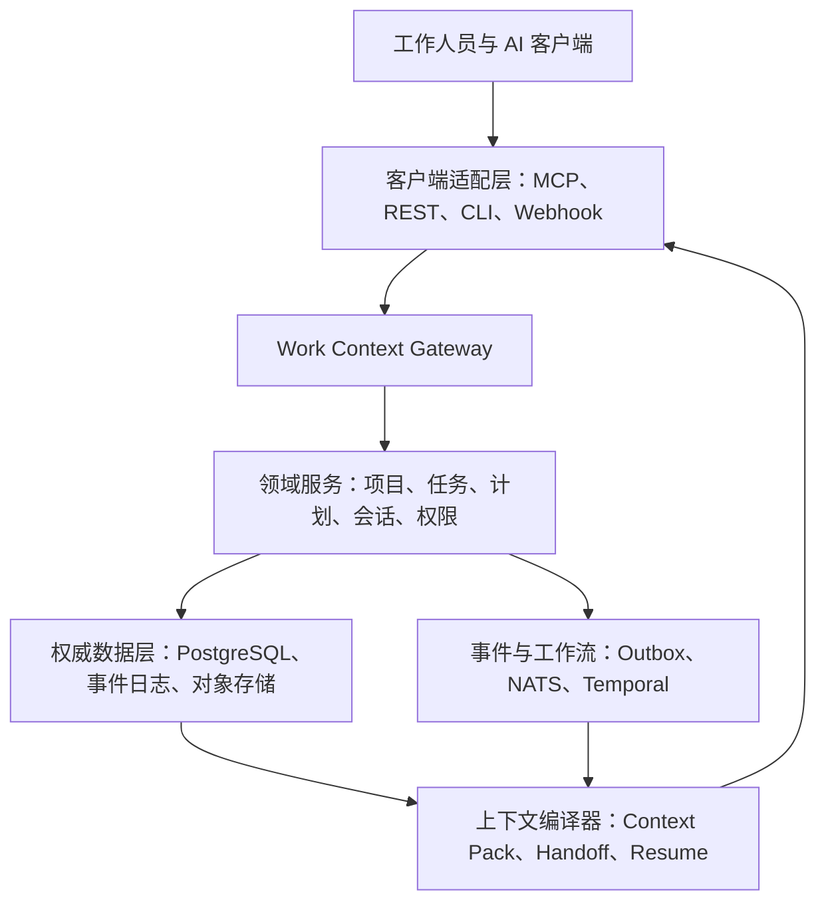
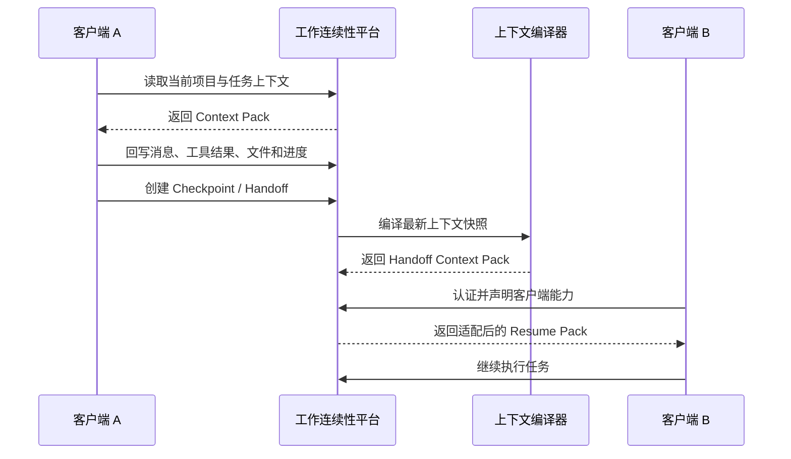
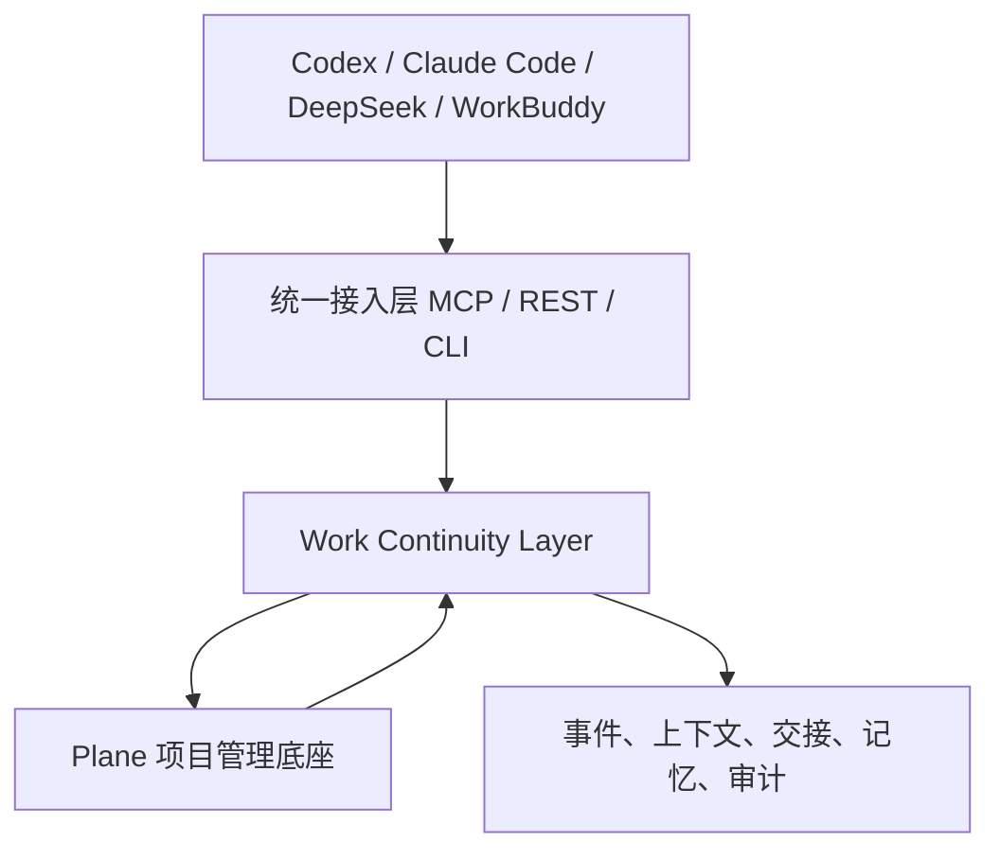
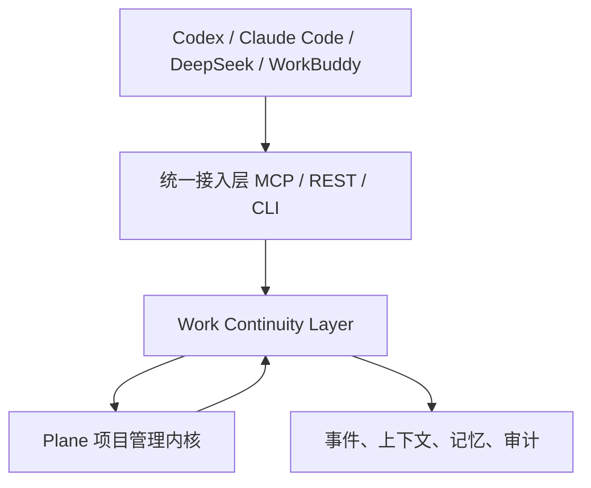
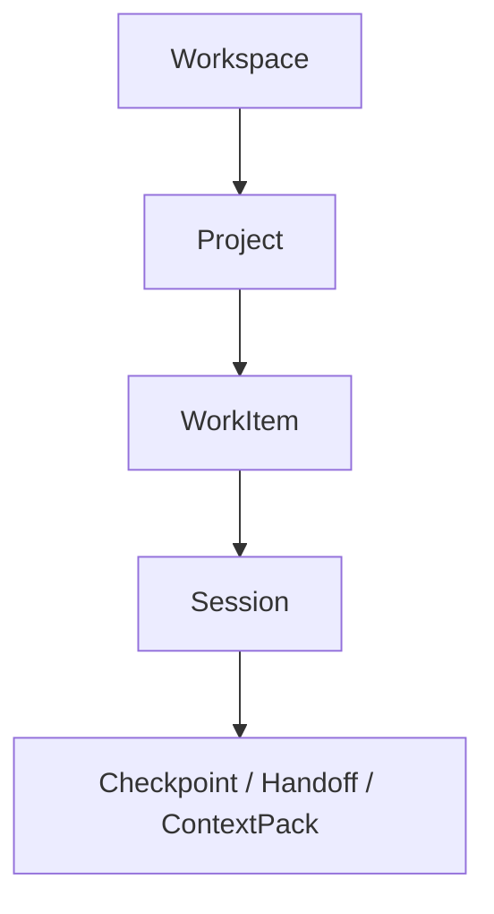
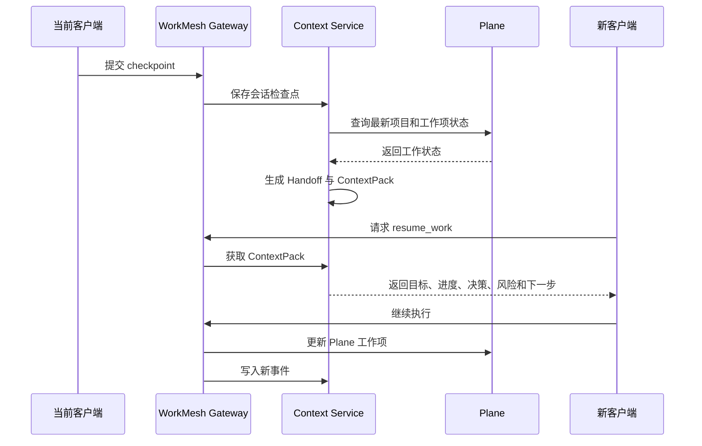
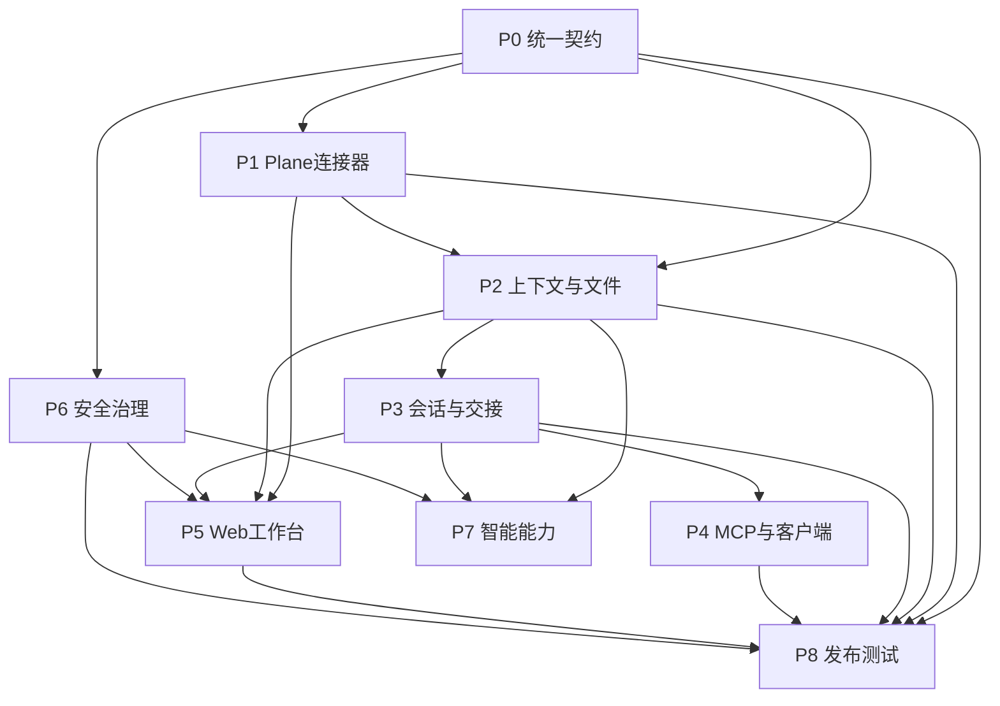

# PlaneMem
项目记忆：多人协同，多AI终端协同开发，记忆统一。
# 客户端无关的工作连续性平台设计方案

> 当前实现缺口与待办项见：[TODO.md](TODO.md)。该清单按 P0–P8 对照本文件、运行时代码和验证证据整理。

## 核心结论

你要建设的不是一个“把 Codex、Claude Code、DeepSeek、WorkBuddy 放在一起的聊天聚合器”，而是一套独立于任何 AI 客户端的：

> **工作连续性操作系统（Work Continuity OS）**

可以暂定产品名为：

- **WorkMesh：工作协同网**
- **WorkOS：工作操作系统**
- **Work Continuity Hub：工作连续性中心**

系统的核心关系应该是：

```text
工作人员管理的是项目、任务、计划、成果和上下文
AI 客户端只是完成工作的入口和执行端
平台才是工作事实、进度和上下文的唯一来源
```

Codex、Claude Code、DeepSeek、WorkBuddy 未来都可以替换，但以下内容必须保留在平台中：

- 项目目标
- 工作范围
- 当前任务
- 计划版本
- 已完成内容
- 未完成内容
- 决策记录
- 风险和阻塞
- 文件与代码
- 工具执行结果
- 检查点
- 下一步行动
- 权限和审计记录

系统的最大价值是：

> 用户更换 AI 客户端时，不需要重新解释项目背景，不需要重新整理任务，不需要重新回忆已经做过什么，能够在新的客户端中继续工作。

---

# 一、为什么现有 AI 客户端无法承担这个系统

当前 Codex、Claude Code、DeepSeek、WorkBuddy 等工具，主要解决的是：

- 当前会话中的问答
- 当前任务中的代码生成
- 当前窗口中的文件操作
- 当前客户端内部的上下文管理
- 当前模型的工具调用

它们通常不负责完整管理：

- 企业项目的长期目标
- 多阶段计划
- 跨客户端工作状态
- 多人责任分工
- 任务依赖关系
- 决策版本
- 风险闭环
- 原始证据和成果文件
- 客户端更换后的上下文恢复
- 组织级知识沉淀

如果把聊天记录直接当作项目管理系统，会出现几个问题：

1. **上下文属于客户端**

   用户换一个客户端，原来的对话记忆可能无法继续使用。

2. **任务状态没有结构化**

   “已经完成”“正在处理”“等待确认”“被什么阻塞”，通常隐藏在聊天内容中。

3. **计划和事实混在一起**

   原计划、修改后的计划、实际完成情况、临时想法可能无法区分。

4. **没有统一来源**

   AI 说过的话、用户确认的事实、系统执行的结果、模型推断的结论可能被混在一起。

5. **无法审计**

   很难回答：

   - 谁修改了计划？
   - 为什么修改？
   - 使用了哪个客户端？
   - AI 的结论来自哪些文件？
   - 哪个工具真正执行了操作？
   - 这个结果是否经过人工确认？

6. **上下文会不断膨胀**

   不能把所有历史对话每次都塞给模型，否则会导致成本高、检索慢、重点丢失、模型注意力下降。

因此，系统必须把“工作事实”和“聊天过程”分开。

---

# 二、总体产品定位

## 2.1 产品职责

工作连续性平台负责管理：

- 工作空间
- 项目
- 工作流
- 目标
- 阶段
- 任务
- 任务依赖
- 计划版本
- 进度
- 决策
- 风险
- 交付物
- 知识
- 会话
- AI 执行记录
- 检查点
- 客户端连接
- 上下文包
- 权限
- 审计

## 2.2 客户端职责

AI 客户端负责：

- 接收用户意图
- 读取当前工作上下文
- 生成内容
- 执行工具
- 修改代码或文档
- 调用外部系统
- 反馈执行结果
- 将结果回写平台

客户端不应该拥有项目的最终事实。

例如，AI 客户端可以建议：

```text
这个任务似乎已经完成。
```

但不能直接把任务改成 `done`。

平台应该生成一个待确认事件：

```text
TaskCompletionCandidateCreated
```

由用户或有权限的项目负责人确认后，才生成：

```text
WorkItemStatusChanged
```

这与工业系统中“AI 辅助判断、人员确认、结果可追溯”的管理方式一致。

---

# 三、总体架构



整体分成七层。

## 3.1 工作事实层

管理：

- 项目
- 目标
- 任务
- 计划
- 决策
- 风险
- 依赖
- 进度
- 成果

这是系统的业务核心。

## 3.2 会话与执行层

管理：

- 哪个用户
- 使用哪个客户端
- 哪次会话
- 调用了哪个模型
- 使用了哪些工具
- 生成了哪些结果
- 执行是否成功
- 是否需要人工确认

会话是执行过程，不是项目事实本身。

## 3.3 上下文编译层

把平台中的工作事实编译成适合不同客户端使用的上下文包：

- JSON
- Markdown
- MCP Resource
- REST 响应
- CLI 启动文件
- Webhook 推送
- 本地 `.workctx/bootstrap.md`

## 3.4 客户端适配层

对接：

- Codex
- Claude Code
- DeepSeek
- WorkBuddy
- 自研 Agent
- IDE 插件
- 企业内部机器人
- 浏览器工作台
- 命令行工具

每个客户端的接入能力不一样，因此需要能力协商和多级降级。

## 3.5 事件与工作流层

负责：

- 事件追加
- 事件投影
- 异步任务
- 上下文生成
- 文件解析
- 索引构建
- 通知分发
- 计划提醒
- 长任务恢复

## 3.6 权限与治理层

负责：

- 身份认证
- 组织权限
- 项目权限
- 数据密级
- 客户端能力
- AI 模型调用权限
- 工具调用权限
- 命令执行权限
- 外发权限
- 审计和留痕

## 3.7 交互工作台

工作台不应该首先展示“你正在使用哪个 AI 客户端”，而应该展示：

- 今天应该做什么
- 哪些任务被阻塞
- 哪些项目发生变化
- 哪些决策等待确认
- 哪些计划已经偏离
- 最近完成了什么
- 下一步是什么

客户端应当成为工作台中的一个入口，而不是系统的中心。

---

# 四、核心领域模型

建议把核心对象分成三组。

## 4.1 工作事实对象

| 对象 | 作用 |
|---|---|
| Tenant | 租户或组织 |
| Workspace | 工作空间，例如研发部、项目组或客户空间 |
| Project | 项目 |
| Workstream | 项目中的工作流或专业方向 |
| Objective | 项目目标或阶段目标 |
| Milestone | 阶段里程碑 |
| WorkItem | 任务、问题、需求、行动项 |
| Dependency | 任务之间的依赖关系 |
| Plan | 计划主对象 |
| PlanRevision | 计划版本 |
| Decision | 已确认的决策 |
| Risk | 风险 |
| Issue | 问题或异常 |
| Artifact | 文档、代码、图片、数据、报告 |
| KnowledgeItem | 已确认、可复用的知识 |

## 4.2 执行过程对象

| 对象 | 作用 |
|---|---|
| ClientConnection | 某个客户端连接 |
| Session | 一次客户端工作会话 |
| AgentRun | 一次 AI 执行 |
| ToolCall | 一次工具调用 |
| Checkpoint | 当前工作的检查点 |
| Handoff | 从一个客户端交接到另一个客户端 |
| ContextPack | 为客户端编译的上下文包 |
| SyncCursor | 增量同步游标 |
| Conflict | 多端修改冲突 |

## 4.3 治理对象

| 对象 | 作用 |
|---|---|
| Permission | 权限 |
| Policy | 策略 |
| Approval | 审批 |
| AuditEntry | 审计记录 |
| DataClassification | 数据分级 |
| RetentionPolicy | 数据保留策略 |
| ExportRecord | 数据导出记录 |

核心约束是：

```text
Project、Plan、WorkItem、Decision、Risk、Artifact 是长期工作事实
Session、AgentRun、ToolCall 是执行过程
Checkpoint、Handoff、ContextPack 是跨客户端连续工作的桥梁
Event、AuditEntry 是系统可追溯基础
```

---

# 五、计划与任务管理设计

计划不能只保存成一段 Markdown。

Markdown 可以作为展示格式，但系统内部必须使用结构化对象。

## 5.1 任务状态机

建议采用：

```text
backlog
  ↓
ready
  ↓
in_progress
  ↓
blocked
  ↓
in_review
  ↓
done
  ↓
archived
```

状态变化需要满足约束：

- `blocked` 必须关联阻塞原因
- `in_review` 必须关联交付物或验证记录
- `done` 必须满足验收条件
- `archived` 只能由有权限的角色执行
- 关键任务不能被 AI 静默关闭

## 5.2 任务结构

```json
{
  "work_item_id": "wi_01J9ABC",
  "project_id": "project_001",
  "title": "设计跨客户端上下文同步协议",
  "type": "design",
  "status": "in_progress",
  "priority": "high",
  "owner_id": "user_001",
  "collaborators": ["user_002"],
  "parent_id": "phase_001",
  "dependencies": [
    {
      "work_item_id": "wi_01J9XYZ",
      "type": "blocks"
    }
  ],
  "acceptance_criteria": [
    "定义上下文包格式",
    "定义增量同步接口",
    "定义冲突处理规则"
  ],
  "current_revision": 12,
  "source_refs": [
    "decision://decision_001",
    "artifact://artifact_002"
  ]
}
```

## 5.3 计划版本

每次计划修改都创建新版本：

```json
{
  "plan_id": "plan_001",
  "revision": 8,
  "goal": "建设客户端无关的工作连续性平台",
  "reason": "增加离线同步和企业权限要求",
  "phases": [
    {
      "phase_id": "phase_001",
      "name": "核心领域模型",
      "status": "completed"
    },
    {
      "phase_id": "phase_002",
      "name": "跨客户端同步",
      "status": "in_progress"
    }
  ],
  "created_by": "user_001",
  "created_at": "2026-10-20T08:00:00Z"
}
```

系统必须能够查看：

- 计划版本 1 做了什么
- 计划版本 2 为什么修改
- 哪些任务被增加
- 哪些任务被删除
- 哪些截止时间发生变化
- 谁确认了变化
- 当前计划与原始计划偏差多少

---

# 六、跨客户端连续工作流程

下面是系统最核心的流程。



## 6.1 客户端 A 开始工作

客户端读取：

- 项目目标
- 当前计划
- 当前工作项
- 已确认决策
- 相关文件
- 上次检查点
- 当前风险
- 最近执行结果
- 下一步行动

## 6.2 客户端 A 工作过程中

客户端回写：

- 用户指令
- AI 输出
- 工具调用
- 文件修改
- 测试结果
- 新发现的问题
- 可能的新决策
- 任务进度建议

其中，普通过程记录可以自动保存；关键事实需要进入确认流程。

## 6.3 用户点击“切换客户端”

系统生成一个不可变的 Handoff：

```json
{
  "handoff_id": "handoff_001",
  "from_session_id": "session_a",
  "target_work_item_id": "wi_001",
  "completed": [
    "完成数据模型初稿",
    "确定采用事件追加模型"
  ],
  "in_progress": [
    "正在设计离线同步"
  ],
  "decisions": [
    "客户端不是权威事实源",
    "采用统一 Context API"
  ],
  "open_questions": [
    "是否需要支持多人同时编辑计划"
  ],
  "next_actions": [
    "定义事件封套",
    "定义增量同步接口"
  ],
  "risks": [
    "部分客户端不支持 MCP"
  ],
  "artifacts": [
    "artifact://design-draft.md"
  ]
}
```

## 6.4 客户端 B 恢复

客户端 B 不需要重新读取所有聊天记录，而是读取：

- 项目稳定规则
- 当前工作项
- Handoff
- 已确认决策
- 当前任务的文件
- 需要解决的问题
- 下一步动作
- 必要的历史引用

系统可以自动生成：

```text
你现在继续处理工作项 WI-001。

项目目标：
建设客户端无关的工作连续性平台。

当前阶段：
跨客户端同步设计。

已完成：
1. 确定平台是唯一事实源。
2. 确定客户端通过适配器接入。
3. 确定采用事件追加和上下文快照。

当前正在处理：
离线事件队列与断点续传。

下一步：
1. 定义事件封套。
2. 定义上传确认机制。
3. 设计冲突处理。

不要重新设计已经确认的架构，除非发现新的事实冲突。
```

---

# 七、统一工作上下文协议 WCP

建议建立一个自己的内部标准：

> **WCP：Work Context Protocol，工作上下文协议**

WCP 不是用来替代 MCP 的新模型协议，而是平台自己的业务契约。

## 7.1 WCP 的作用

WCP 统一描述：

- 项目
- 任务
- 计划
- 会话
- 检查点
- 交接
- 上下文
- 事件
- 文件
- 权限
- 客户端能力

MCP、REST、CLI、Webhook 都只是 WCP 的不同传输和适配方式。

## 7.2 关键 API

```text
POST /v1/workspaces
POST /v1/projects
GET  /v1/projects/{project_id}
GET  /v1/projects/{project_id}/state
GET  /v1/projects/{project_id}/resume

POST /v1/work-items
GET  /v1/work-items/{work_item_id}
PATCH /v1/work-items/{work_item_id}

POST /v1/sessions
POST /v1/sessions/{session_id}/events
POST /v1/sessions/{session_id}/checkpoint
POST /v1/sessions/{session_id}/handoff
POST /v1/sessions/{session_id}/close

GET  /v1/work-items/{work_item_id}/context
POST /v1/context/query
GET  /v1/context-packs/{pack_id}

POST /v1/events:batch
GET  /v1/sync/changes?cursor=
POST /v1/sync/ack

GET  /v1/stream
GET  /v1/conflicts
POST /v1/conflicts/{conflict_id}/resolve

GET  /v1/client-capabilities
POST /v1/client-connections
```

关键命令必须带：

```text
tenant_id
workspace_id
actor_id
client_id
session_id
idempotency_key
expected_revision
```

响应必须返回：

```text
revision
etag
server_cursor
accepted_events
rejected_events
conflict_ids
```

## 7.3 乐观并发控制

修改工作项时携带版本号：

```http
PATCH /v1/work-items/wi_123
If-Match: W/"revision-18"
```

如果服务器当前版本已经是 19，则不允许直接覆盖，而是返回：

```http
409 Conflict
```

同时生成：

```text
ConflictDetected
```

---

# 八、MCP 的正确定位

MCP 适合做客户端访问工作平台的适配层。

官方 MCP TypeScript SDK 将服务器能力分为 `resources`、`tools` 和 `prompts`，能够让支持 MCP 的宿主访问外部数据和工具。[ts.sdk.modelcontextprotocol.io](https://ts.sdk.modelcontextprotocol.io/v2/?utm_source=chatgpt.com)

但 MCP 不应该承担：

- 项目主数据
- 任务版本
- 权限模型
- 审计模型
- 冲突处理
- 事件溯源
- 组织级计划

## 8.1 MCP Resources

```text
work://workspace/{workspace_id}
work://project/{project_id}
work://project/{project_id}/current-state
work://project/{project_id}/plan
work://work-item/{work_item_id}
work://work-item/{work_item_id}/context
work://work-item/{work_item_id}/timeline
work://work-item/{work_item_id}/decisions
work://work-item/{work_item_id}/artifacts
work://session/{session_id}/handoff
```

## 8.2 MCP Tools

```text
create_work_item
update_work_item
record_checkpoint
create_handoff
record_decision
record_risk
search_project_context
attach_artifact
suggest_plan_update
request_approval
resolve_conflict
```

## 8.3 MCP Prompts

```text
resume_work
review_current_plan
prepare_handoff
analyze_blockers
summarize_recent_progress
review_decisions
prepare_daily_brief
```

由于 MCP 规范和各客户端实现可能持续变化，适配器必须声明：

```json
{
  "mcp_protocol_version": "2026-07-28",
  "supported_features": [
    "resources",
    "tools",
    "prompts"
  ]
}
```

平台核心 WCP 版本独立维护，不能把业务数据模型绑定在某一个 MCP 版本上。

---

# 九、上下文编译器设计

上下文编译器是本系统最重要的智能模块之一。

它不应该简单地“把聊天记录拼起来”，而应该按权限、相关性、时效性和上下文预算编译上下文。

## 9.1 五层上下文

### L0：项目宪章

长期稳定内容：

- 项目目标
- 项目背景
- 业务边界
- 术语
- 技术基线
- 不可违反的约束
- 组织规则

### L1：当前工作状态

- 当前工作项
- 当前阶段
- 当前负责人
- 已完成内容
- 未完成内容
- 下一步
- 当前阻塞
- 验收标准

### L2：已确认事实

- 已确认决策
- 业务规则
- 技术取舍
- 用户明确偏好
- 已批准方案
- 已验证结论

### L3：近期活动

- 最近会话
- 最近文件修改
- 最近工具调用
- 最近测试结果
- 最近错误
- 最近风险
- 最近任务变化

### L4：按需检索内容

- 历史对话
- 旧版本文件
- 相关案例
- 其他项目
- 知识库资料
- 相似问题
- 过去的失败经验

默认只发送 L0 到 L3，L4 提供索引和引用，需要时再召回。

## 9.2 Context Pack 结构

```json
{
  "pack_id": "pack_001",
  "pack_version": 12,
  "project_id": "project_001",
  "work_item_id": "wi_001",
  "generated_at": "2026-10-20T08:00:00Z",
  "expires_at": "2026-10-20T12:00:00Z",
  "budget": {
    "max_tokens": 32000,
    "used_tokens": 18400
  },
  "project_manifest": {},
  "current_objective": {},
  "active_plan": {},
  "current_state": {},
  "confirmed_decisions": [],
  "constraints": [],
  "open_questions": [],
  "risks": [],
  "next_actions": [],
  "artifacts": [],
  "recent_events": [],
  "source_refs": [],
  "sensitivity": "internal",
  "pack_hash": "sha256:..."
}
```

## 9.3 上下文选择策略

上下文编译器至少考虑：

```text
权限是否允许
与当前任务的关联度
内容是否已经过确认
内容的新鲜程度
内容的来源可信度
内容的敏感等级
客户端上下文窗口
当前任务优先级
是否为必须保留的项目约束
```

每一条上下文都必须保留：

```text
source_id
source_type
created_at
updated_at
author
confidence
confirmed
sensitivity
```

这样可以区分：

```text
用户确认的事实
AI 推断的候选事实
未确认的模型总结
文件中的原始证据
```

---

# 十、事件模型与同步机制

## 10.1 事件追加，不覆盖历史

所有关键变化都追加事件：

```text
ProjectCreated
PlanRevisionCreated
WorkItemCreated
WorkItemStatusChanged
DecisionRecorded
RiskRaised
ArtifactPublished
SessionStarted
ToolCallCompleted
CheckpointCreated
HandoffCreated
ConflictDetected
ConflictResolved
```

修正不是覆盖原事件，而是追加：

```text
DecisionSuperseded
PlanRevisionCreated
ConflictResolved
```

## 10.2 事件封套

建议采用 CloudEvents 风格的事件封套。CloudEvents 的目标是使用统一事件元数据，降低不同事件源之间的耦合。[cloudevents.io](https://cloudevents.io/?session_ref=direct\&utm_source=chatgpt.com)

```json
{
  "specversion": "1.0",
  "type": "work.item.status_changed",
  "id": "01J9ABC123",
  "source": "workmesh://project/project_001",
  "subject": "work-item/wi_001",
  "time": "2026-10-20T08:00:00Z",
  "datacontenttype": "application/json",

  "tenant_id": "tenant_001",
  "workspace_id": "workspace_001",
  "project_id": "project_001",
  "aggregate_type": "work_item",
  "aggregate_id": "wi_001",
  "aggregate_version": 19,

  "actor_id": "user_001",
  "actor_type": "human",
  "client_id": "claude-code",
  "session_id": "session_001",
  "correlation_id": "corr_001",
  "causation_id": "event_abc",
  "idempotency_key": "client-event-001",

  "sensitivity": "internal",
  "data": {
    "old_status": "in_progress",
    "new_status": "in_review",
    "reason": "完成设计初稿并通过自检"
  }
}
```

## 10.3 数据处理方式

建议使用：

```text
业务命令
  ↓
PostgreSQL 事务写入
  ↓
domain_events
  ↓
transactional_outbox
  ↓
NATS JetStream
  ↓
投影服务、通知服务、索引服务、审计服务
```

NATS JetStream 官方文档提供了持久化、消息重放和至少一次投递语义，适合用于跨客户端事件广播和离线恢复。[NATS Documentation](https://docs.nats.io/concepts/jetstream?utm_source=chatgpt.com)

MVP 不建议直接引入 Kafka。除非后续出现：

- 极大规模事件分析
- 多地域流式处理
- 大量实时数据指标
- 专门的数据平台团队

否则 NATS JetStream 更容易私有化部署和维护。

---

# 十一、离线与断点续接

每台安装了 Bridge 的设备都运行一个轻量级本地同步组件。

## 11.1 本地 Bridge

建议使用：

```text
Node.js / TypeScript
SQLite
本地加密存储
本地事件队列
文件监控
命令行接口
```

本地目录可以约定为：

```text
.workctx/
├── project.json
├── bootstrap.md
├── current-context.json
├── checkpoints/
├── outbox/
├── cache/
└── logs/
```

## 11.2 本地 outbox

```json
{
  "local_id": "local_001",
  "event_id": "01J9ABC",
  "aggregate_id": "wi_001",
  "aggregate_version": 21,
  "payload": {},
  "status": "pending",
  "retry_count": 0,
  "created_at": "2026-10-20T08:00:00Z"
}
```

处理流程：

1. 客户端产生事件。
2. Bridge 先写入 SQLite。
3. 本地事件标记为 `pending`。
4. 网络可用时批量上传。
5. 服务端根据 `event_id` 去重。
6. 服务端返回成功或冲突结果。
7. Bridge 标记本地事件为 `acked` 或 `conflict`。
8. Bridge 根据游标拉取服务端变化。
9. 本地重新生成上下文缓存。
10. 新客户端启动时优先读取未确认事件和最新 Context Pack。

这样，即使发生：

- 网络中断
- 客户端崩溃
- 电脑重启
- 服务重启
- 重复上传
- 多端同时修改

也不会因为没有实时连接而丢失工作记录。

---

# 十二、冲突处理

不同类型的数据不能采用同一种合并策略。

| 数据类型 | 建议处理方式 |
|---|---|
| 用户消息 | 追加 |
| AI 输出 | 追加 |
| 工具调用 | 追加 |
| 文件版本 | 版本化 |
| 工作项描述 | 可采用版本合并 |
| 标签 | 可采用最后写入，但保留历史 |
| 任务状态 | 乐观并发控制 |
| 负责人 | 禁止静默覆盖 |
| 截止时间 | 冲突后人工确认 |
| 计划版本 | 生成计划冲突 |
| 审批状态 | 必须人工确认 |
| 审计记录 | 只追加 |
| 富文本说明 | 可采用 Yjs 或 Automerge |

Yjs 提供基于 IndexedDB 的离线持久化，Automerge 支持本地优先和离线同步，因此它们适合用于协同编辑笔记、说明文档和富文本内容。[Yjs Docs](https://docs.yjs.dev/ecosystem/database-provider/y-indexeddb?utm_source=chatgpt.com)

但不建议把整个项目管理系统都做成 CRDT。原因是：

- 权限规则会更复杂
- 审批状态不适合自动合并
- 责任人不能被静默覆盖
- 计划基线需要清晰版本
- 生产类变更需要明确审批
- 审计要求不能被合并逻辑掩盖

---

# 十三、记忆系统设计

记忆系统需要和具体框架解耦。

建议抽象出：

```text
MemoryService
```

而不是让业务代码直接绑定某个 Mem0、LangChain 或其他记忆框架。

## 13.1 MemoryService 接口

```text
writeCandidate()
retrieve()
promoteToFact()
supersede()
forget()
delete()
trace()
```

## 13.2 记忆分层

### 会话记忆

只对当前 Session 有效：

- 当前讨论
- 临时变量
- 当前推理过程
- 当前工具返回值

### 工作项记忆

对当前任务有效：

- 当前状态
- 当前文件
- 当前约束
- 当前失败尝试
- 当前下一步

### 项目记忆

对整个项目有效：

- 项目目标
- 关键决策
- 技术基线
- 项目术语
- 重要风险

### 组织知识

可以跨项目复用：

- 标准规范
- 企业 SOP
- 最佳实践
- 成功案例
- 失败案例
- 经验规则

AI 可以提出候选记忆，但不能未经确认直接将推断写成组织事实。

例如：

```text
AI 发现候选：
“这个团队似乎偏好 PostgreSQL。”

状态：
candidate

用户确认后：
“本项目基础数据库采用 PostgreSQL。”

状态：
confirmed_fact
```

---

# 十四、AI 能力设计

系统中的 AI 不应该直接替代项目管理，而应围绕工作连续性提供辅助。

## 14.1 上下文编译 Agent

负责：

- 读取项目状态
- 识别当前任务
- 筛选相关历史
- 生成 Resume Pack
- 适配不同客户端上下文窗口
- 输出来源和引用

## 14.2 检查点 Agent

从当前会话中提取：

- 已完成内容
- 未完成内容
- 新增决策
- 新增风险
- 未解决问题
- 下一步
- 相关文件
- 测试结果

输出为候选 Checkpoint，由用户确认。

## 14.3 计划分析 Agent

负责发现：

- 计划延期
- 任务长期未动
- 依赖阻塞
- 资源冲突
- 计划与实际偏差
- 目标和任务不一致
- 重复工作
- 缺少验收条件

## 14.4 决策抽取 Agent

识别：

- 用户明确要求
- 已确认方案
- 约束条件
- 技术取舍
- 不可违反规则
- 已否决方案

但决策只有在“确认”后才升级为事实。

## 14.5 工作简报 Agent

自动生成：

- 今日重点
- 昨日变化
- 当前阻塞
- 待确认决策
- 计划偏差
- 需要协作的人员
- 近期风险

这可以让系统主动“说话”，而不是让工作人员自己逐个功能页面寻找问题。

---

# 十五、推荐技术栈

## 15.1 最终推荐

对于当前这个产品，我建议：

> **TypeScript 作为主栈，Python 作为 AI/文档处理侧车；首期采用模块化单体，成熟后再拆分高并发同步服务。**

原因是：

- MCP 适配器优先支持 TypeScript
- Web、CLI、Bridge、MCP Server 可以共享类型
- API 契约和领域模型可以共享 JSON Schema
- 前后端团队协作成本低
- 更适合快速连接 Codex、Claude Code、DeepSeek、WorkBuddy 等不同客户端
- AI 产品的工具、协议、SDK 生态对 TypeScript 支持较好
- 对企业级 50 至几千名用户的规模已经足够

## 15.2 技术选型表

| 层次 | 推荐技术 | 说明 |
|---|---|---|
| 主语言 | TypeScript | Web、API、MCP、CLI、Bridge 统一类型 |
| 后端 | NestJS + Fastify | 模块化、依赖注入、权限、验证、测试 |
| 前端 | Next.js App Router | 构建工作台、项目驾驶舱和管理页面 |
| 协议 | OpenAPI 3.1 + JSON Schema 2020-12 | 对外稳定契约 |
| 事件格式 | CloudEvents 风格 | 统一事件封套 |
| 客户端协议 | MCP + REST + CLI + Webhook | 支持不同客户端能力 |
| 主数据库 | PostgreSQL 18 | 权威事实、版本、事务、JSONB |
| 向量检索 | pgvector | MVP 阶段先减少基础设施数量 |
| 消息系统 | NATS JetStream | 持久化、重放、至少一次投递 |
| 工作流 | Outbox 起步，Temporal P2 | 复杂长流程和故障恢复再引入 |
| 对象存储 | Ceph RGW 或企业现有 S3 | 代码、文档、图片、数据集和报告 |
| 缓存 | Redis | 缓存、限流、短期锁，不作为主数据库 |
| 身份 | Keycloak | OIDC、OAuth2、SSO、组织和角色 |
| 策略 | OPA + Rego | 项目级 ABAC、数据级策略、工具调用策略 |
| 搜索 | PostgreSQL FTS + pgvector，后期 OpenSearch | 先简单，规模增长后使用混合检索 |
| 观测 | OpenTelemetry + Prometheus + Grafana | 统一 Trace、Metrics、Logs |
| AI Worker | Python + FastAPI + Pydantic | 文档解析、抽取、RAG、评测、模型调用 |
| 本地 Bridge | Node.js + TypeScript + SQLite | 离线事件队列和客户端接入 |
| 部署 | Docker Compose 起步，Kubernetes 企业版 | 避免第一天就引入复杂微服务 |

NestJS 官方定位是面向高效、可扩展 Node.js 服务端应用的框架，并支持 TypeScript 和 Fastify 适配。Next.js 官方定位为构建全栈 Web 应用的 React 框架。[NestJS - A progressive Node.js framework](https://docs.nestjs.com/recipes/documentation?utm_source=chatgpt.com)

PostgreSQL 可以承担主数据、版本数据、事件日志和权限过滤。其行级安全策略可以让数据库层对不同用户的数据访问进行限制。[postgresql.org](https://www.postgresql.org/docs/current/ddl-rowsecurity.html?utm_source=chatgpt.com)

Keycloak 适合承担 OIDC 登录、OAuth2 客户端认证、角色和授权能力。[keycloak.org](https://www.keycloak.org/docs/latest/authorization_services/index.html?utm_source=chatgpt.com)

OPA 可以把项目级和数据级权限从业务代码中抽离，用 Rego 表达复杂授权策略。[Open Policy Agent](https://www.openpolicyagent.org/docs?utm_source=chatgpt.com)

OpenTelemetry 可以统一采集 Trace、Metrics、Logs 和上下文传播信息。[opentelemetry.io](https://opentelemetry.io/docs/concepts/signals/?utm_source=chatgpt.com)

## 15.3 为什么不建议首期使用 Java、Go、Rust 全部混合

Java、Go、Rust 都有优势。

### Java

适合：

- 大型集团
- 长期企业维护
- 复杂权限
- 国产化和传统企业集成
- 大量 Java 团队

Spring Boot 官方强调其适合构建可独立运行、生产级的 Spring 应用，并提供健康检查、指标和外部化配置等能力。[spring.io](https://spring.io/projects/spring-boot?utm_source=chatgpt.com)

### Go

适合：

- 高并发同步
- 低资源占用
- 单二进制私有化交付
- 事件网关
- 连接器运行时

### Rust

适合：

- 极高性能同步核心
- 本地数据库
- 高可靠边缘组件
- 未来的高性能 CRDT 或索引组件

但首期全部混合使用，会增加：

- 招聘成本
- 工程规范数量
- SDK 维护成本
- 跨语言类型同步成本
- 部署复杂度
- 调试成本

建议路线是：

```text
P0/P1：TypeScript 模块化单体 + Python Worker
P2：根据性能数据，把 Sync Gateway 或 Event Ingest 拆成 Go
P3：大型客户需要时增加 Java 集成服务
```

Temporal 适合处理长时间运行、可恢复的工作流。官方文档将 Durable Execution 定义为即使发生崩溃、网络故障或服务器中断，工作流也能够恢复并继续执行。[Temporal Documentation](https://docs.temporal.io/temporal?utm_source=chatgpt.com)

因此建议：

- 第一阶段：PostgreSQL Outbox + NATS
- 第二阶段：复杂长任务再引入 Temporal
- 不要一开始就让所有普通任务都运行在 Temporal 上

---

# 十六、推荐代码仓库结构

```text
workmesh/
├── apps/
│   ├── web-console/
│   ├── api/
│   ├── mcp-server/
│   ├── cli/
│   └── bridge/
│
├── packages/
│   ├── domain-contracts/
│   ├── event-contracts/
│   ├── context-pack/
│   ├── client-sdk/
│   ├── policy-sdk/
│   ├── auth-sdk/
│   └── observability/
│
├── workers/
│   ├── projection-worker/
│   ├── index-worker/
│   ├── artifact-worker/
│   ├── ai-enrichment-worker/
│   └── notification-worker/
│
├── services/
│   ├── work-service/
│   ├── plan-service/
│   ├── session-service/
│   ├── context-service/
│   ├── artifact-service/
│   ├── connector-service/
│   └── audit-service/
│
├── schemas/
│   ├── context-pack.schema.json
│   ├── work-item.schema.json
│   ├── event-envelope.schema.json
│   └── client-capability.schema.json
│
├── infra/
│   ├── docker-compose/
│   ├── keycloak/
│   ├── postgres/
│   ├── nats/
│   ├── opentelemetry/
│   └── kubernetes/
│
└── docs/
    ├── architecture/
    ├── protocol/
    ├── security/
    └── adapters/
```

---

# 十七、工作台的产品界面

## 17.1 首页：我的工作

首页应该展示：

- 今日最重要任务
- 所有项目的健康度
- 被阻塞的工作
- 等待用户确认的事项
- 最近发生的变化
- 计划延期
- AI 建议的下一步
- 最近打开的工作项
- 最近使用的客户端

重点是：

```text
先展示工作，再展示工具
```

## 17.2 项目驾驶舱

项目页面包括：

- 项目目标
- 里程碑
- 当前计划
- 完成进度
- 任务分布
- 风险
- 决策
- 关键成果
- 最近活动
- 团队成员
- 当前运行中的客户端会话

## 17.3 工作项页面

工作项页面包括：

- 任务目标
- 验收标准
- 当前状态
- 负责人
- 依赖关系
- 当前上下文
- 相关文件
- 历史检查点
- 最近会话
- 决策
- 风险
- 下一步
- “继续工作”
- “切换客户端”
- “生成交接包”

## 17.4 系统主动表达

系统应主动提示：

```text
这个任务已经连续 3 天没有进展，原因可能是等待接口确认。
```

```text
当前计划与最新决策不一致，建议生成计划修订版本。
```

```text
客户端 A 生成了新的设计，但还没有关联到任何工作项。
```

```text
客户端 B 发现了新的风险，是否加入项目风险清单？
```

```text
该任务已完成代码修改，但缺少验证结果，暂不建议关闭。
```

这会让系统从“功能菜单集合”转变为“能够理解工作状态的工作产品”。

---

# 十八、实施路线

## P0：核心概念验证，4 至 6 周

目标只验证一件事：

> 用户从客户端 A 切换到客户端 B 后，可以继续完成同一项工作。

范围：

- Workspace
- Project
- WorkItem
- Session
- Checkpoint
- Handoff
- Context Pack
- 一个 MCP Adapter
- 一个 REST Adapter
- 一个 CLI Bridge
- PostgreSQL
- 基础事件日志

验收标准：

- 创建项目
- 创建任务
- 客户端 A 开始工作
- 产生执行记录
- 生成检查点
- 切换到客户端 B
- B 读取上下文
- B 继续完成任务
- 全过程可以回放

## P1：MVP，8 至 12 周

增加：

- 项目管理
- 计划管理
- 计划版本
- 决策
- 风险
- 文件和成果
- Context Compiler
- 基础权限
- Keycloak
- 对象存储
- Web 工作台
- MCP、REST、CLI 三种接入
- 基础审计
- 事件投影

暂时不做：

- 复杂知识图谱
- 多人实时富文本
- 多地域容灾
- 大规模数据分析
- 插件市场
- 全自动计划变更

## P2：Beta，6 至 8 周

增加：

- SQLite 离线 outbox
- 增量同步
- SSE/WebSocket
- 冲突中心
- pgvector
- 上下文预算控制
- AI 检查点抽取
- AI 计划偏差分析
- OpenTelemetry
- Golden Context Pack 测试集
- 多客户端实际适配

## P3：企业版，8 至 12 周

增加：

- 多租户
- ABAC
- OPA
- 高可用
- NATS JetStream
- Temporal
- WORM 审计
- 数据分级
- 脱敏
- 审批流
- 私有化安装包
- 企业 SSO
- 数据驻留
- 国产化部署适配

## P4：生态版

增加：

- 客户端 SDK
- 适配器 SDK
- 内部插件市场
- 行业模板
- 项目模板
- 企业知识包
- 跨组织协作
- 工作回放
- 工作效率分析
- 自动化工作流
- 多智能体协作任务

---

# 十九、成本估算

以下为研发投入的粗略估算，不含模型调用成本、硬件采购和等保测评费用。

| 阶段 | 人员规模 | 周期 | 研发费用估算 |
|---|---:|---:|---:|
| P0 概念验证 | 2 至 3 人 | 4 至 6 周 | 15 至 30 万元 |
| P1 MVP | 4 至 6 人 | 3 至 4 个月 | 60 至 120 万元 |
| P2 Beta | 5 至 8 人 | 2 至 3 个月 | 50 至 100 万元 |
| P3 企业版 | 6 至 10 人 | 6 至 9 个月 | 180 至 400 万元 |
| P4 生态版 | 8 至 15 人 | 9 至 18 个月 | 400 至 800 万元以上 |

如果增加以下要求，费用会明显上升：

- 国产化适配
- 等保测评
- 多活容灾
- 复杂审批
- 高并发实时协作
- 行业知识库
- 多模型路由
- 外部系统深度集成
- 大规模私有化交付
- 生产级安全隔离

---

# 二十、验收指标

建议从一开始就建立以下指标。

## 连续工作指标

- 客户端切换后恢复时间 p95 小于 5 秒
- 用户无需重新解释背景
- 上一次检查点恢复成功率大于 99%
- 未确认本地事件零丢失
- 任务状态与事件日志一致

## 同步指标

- 在线事件确认 p95 小于 1 秒
- 重复事件去重成功率 100%
- 断网恢复后自动补传
- 服务端重启后可继续消费
- 事件可以按游标重放

## 上下文指标

- Context Pack 必须包含来源引用
- Context Pack 必须带版本和 hash
- Context Pack 必须按权限过滤
- 超出上下文预算时按优先级裁剪
- 关键项目约束不能被裁剪
- AI 推断不能自动升级为确认事实

## 安全指标

- 越权读取测试全部失败
- 敏感项目不能被低权限客户端读取
- 客户端只能调用授权工具
- 工具调用可以审计
- 外部模型调用可以按数据级别控制
- 重要修改可以回放
- 删除和导出行为可追溯

---

# 二十一、最容易踩的坑

## 1. 把客户端对话当成主数据

正确方式：

```text
聊天记录是原始轨迹
项目、任务、决策、计划才是工作事实
```

## 2. 让不同客户端各自维护上下文

正确方式：

```text
中央平台维护 Canonical Context
每个客户端只获取自己的适配版本
```

## 3. 一开始就把全部系统拆成微服务

正确方式：

```text
先做模块化单体
事件和边界稳定后再拆服务
```

## 4. 让 AI 自动修改所有项目状态

正确方式：

```text
AI 负责建议
系统负责校验
人员确认关键状态
```

## 5. 把全部历史内容放入上下文

正确方式：

```text
稳定上下文直接注入
近期活动摘要注入
历史内容按需检索
```

## 6. 只做文本同步，不同步文件和代码

正确方式：

```text
事件同步
文件版本同步
代码分支和提交引用
工具执行结果同步
```

## 7. 使用最后写入覆盖所有冲突

正确方式：

```text
普通描述可以合并
负责人、截止时间、审批状态必须产生冲突
```

## 8. 只接 MCP

正确方式：

```text
MCP 是优先适配协议
REST 是管理和命令面
CLI 是本地工作面
Webhook 是事件面
Markdown 是最低能力降级方案
```

---

# 二十二、最后的产品边界

这套系统不是：

- 一个更大的聊天窗口
- 一个简单项目管理软件
- 一个单纯知识库
- 一个代码助手
- 一个模型聚合平台
- 一个只围绕 MCP 构建的工具市场

它应该被定义为：

> **面向人员和智能体协同工作的、客户端无关的工作上下文操作系统。**

最重要的架构原则只有四条：

1. **平台管理工作事实，客户端执行工作。**
2. **结构化任务和计划是主数据，聊天记录只是证据。**
3. **事件追加、版本快照和检查点保证工作能够恢复。**
4. **客户端可以替换，WCP 和领域模型不能被客户端绑定。**

建议第一步直接做一个最小闭环：

```text
创建项目
→ 创建任务
→ 在客户端 A 工作
→ 生成检查点
→ 切换客户端 B
→ 恢复上下文
→ 继续完成任务
→ 回写结果
→ 查看完整工作时间线
```

只要这个闭环真实可用，后续再增加计划、知识库、智能体、审批、企业权限和多客户端生态，系统就会沿着正确方向发展。


从github找一个最契合该方案的项目管理系统


# 结论：最契合的是 Plane

推荐项目：

**[makeplane/plane](https://github.com/makeplane/plane)**

Plane 是一个开源、自托管的项目管理系统，定位接近 Jira、Linear、Monday、ClickUp，覆盖项目、工作项、周期、模块、里程碑、文档、附件、依赖关系和分析等核心能力。官方支持 Docker、Kubernetes、REST API、Webhook、OAuth，并且已经提供 MCP Server，可以连接 Claude、ChatGPT、Cursor、VS Code 等 AI 客户端。[GitHub](https://github.com/makeplane/plane?utm_source=chatgpt.com) [Plane](https://developers.plane.so/?utm_source=chatgpt.com)

对你的目标而言，Plane 的价值不只是“有任务看板”，而是它已经具备了构建统一工作系统所需要的几个关键基础：

1. 项目和工作项模型比较完整；
2. 可以自托管，数据可以留在组织自己的环境；
3. 有 REST API，便于接入不同客户端；
4. 有 Webhook，便于实时同步工作状态；
5. 有开源 MCP Server，适合 Codex、Claude Code 等 AI 客户端；
6. 支持 Agent Run，可以记录 AI Agent 的操作过程；
7. 不需要从零开发项目管理、看板、周期、里程碑、附件和权限功能。

不过，Plane 本身还不是完整的“跨客户端工作连续性系统”。最合理的落地方式是：

> **Plane 作为项目与工作项管理底座，外面增加一层 Work Continuity Layer，负责上下文、会话、交接、记忆、事件和审计。**

这样既可以利用成熟的项目管理功能，又能够实现工作人员自由切换 Codex、Claude Code、DeepSeek、WorkBuddy，而不会丢失上下文。

---

## 一、Plane 与你的目标匹配度

Plane 的 GitHub 项目本身已经包含以下核心对象：

| 你的需求 | Plane 对应能力 | 适配情况 |
|---|---|---|
| 工作项目 | Workspace、Project | 已具备 |
| 工作任务 | Work Items | 已具备 |
| 任务状态 | States、Labels、Custom Properties | 已具备 |
| 计划周期 | Cycles | 已具备 |
| 工作模块 | Modules | 已具备 |
| 里程碑 | Milestones | 已具备 |
| 发布计划 | Releases | 已具备 |
| 文档和工作内容 | Pages、Collections、Attachments | 基本具备 |
| 任务依赖 | Relations、Dependencies | 已具备 |
| 团队协作 | Members、Roles、Permissions | 已具备 |
| 进度和分析 | Analytics、Cycle Burndown | 已具备 |
| AI 客户端接入 | MCP、REST API、OAuth | 已具备 |
| 客户端切换 | 需要增加 Context Service | Plane 原生不足 |
| 工作交接 | 需要增加 Handoff Service | Plane 原生不足 |
| 工作记忆 | 需要增加 Memory Service | Plane 原生不足 |
| 上下文快照 | 需要增加 Context Pack | Plane 原生不足 |
| 统一审计 | 需要增加 Audit/Event Service | Plane 原生不足 |
| AI 会话恢复 | 需要增加 Session Service | Plane 原生不足 |

Plane 的 API 已经覆盖项目、工作项、状态、标签、自定义属性、评论、附件、周期、模块、页面、集合、里程碑、计划、发布和时间追踪等对象。[Plane](https://developers.plane.so/api-reference/introduction?utm_source=chatgpt.com)

Plane 官方 MCP Server 目前已经能够操作工作项、评论、附件、依赖、任务层级、周期、模块、里程碑、发布、项目、页面、集合和客户信息等对象。[Plane](https://developers.plane.so/dev-tools/mcp-server?utm_source=chatgpt.com)

---

## 二、推荐的总体架构



从工作人员角度看，只有一个统一的工作系统：

- 在 Codex 中继续工作；
- 切换到 Claude Code；
- 再切换到 DeepSeek 或 WorkBuddy；
- 新客户端通过统一接口读取当前项目、任务、上下文和交接记录；
- 新客户端不依赖旧客户端的聊天窗口；
- 工作状态保存到系统，而不是保存到某一个 AI 客户端的本地会话里。

### 组件职责

#### 1. Plane

负责成熟的项目管理能力：

- Workspace；
- Project；
- Work Item；
- Cycle；
- Module；
- Milestone；
- Release；
- Page；
- Comment；
- Attachment；
- Dependency；
- 用户、团队和权限；
- 基础状态流转和进度统计。

#### 2. Work Continuity Layer

这是你真正需要新增的核心层，建议独立为一个服务，不直接修改 Plane 核心代码。

负责：

- 当前工作上下文；
- 工作会话；
- 工作交接；
- 上下文快照；
- 下一步行动；
- 决策记录；
- 风险记录；
- 关键假设；
- 相关文件和代码引用；
- AI 客户端调用记录；
- 任务变更事件；
- 权限和审计；
- 跨客户端恢复工作。

#### 3. Adapter Gateway

统一适配不同客户端：

- MCP Server；
- REST API；
- CLI；
- Webhook；
- 可选的 OpenAI 兼容接口；
- 可选的 Claude Code Skill；
- 可选的 Codex Skill；
- 可选的 WorkBuddy 插件。

客户端只连接 Adapter Gateway，而不应该分别连接 Plane、数据库、向量库和上下文服务。

---

## 三、Plane 对象如何映射到你的统一工作模型

建议将 Plane 作为底层工作对象系统，同时在外部建立统一的 Work Continuity 数据模型。

| Plane 对象 | 统一工作模型 | 说明 |
|---|---|---|
| Workspace | Organization / Workspace | 组织或个人工作空间 |
| Project | Project | 项目 |
| Work Item | WorkItem | 工作项、任务、缺陷、需求 |
| Cycle | Iteration | 迭代或时间周期 |
| Module | Workstream | 工作流或工作模块 |
| Milestone | Milestone | 阶段目标 |
| Page | Artifact / Knowledge | 工作文档、设计、方案 |
| Comment | Activity / Conversation | 工作过程中的讨论 |
| Relation | Dependency | 依赖关系 |
| Attachment | Evidence / Artifact | 文件、截图、报告、代码产物 |
| Webhook Event | Domain Event | 工作系统事件 |
| Agent Run | Agent Activity | AI Agent 执行记录 |
| Context Pack | Work Context | 当前工作的完整上下文 |
| Handoff | Work Handoff | 工作交接和恢复信息 |
| Session | Work Session | 一次客户端工作会话 |
| Decision | Decision Record | 决策记录 |
| Risk | Risk Record | 风险记录 |
| Audit Log | Immutable Audit | 不可篡改的审计记录 |

建议采用“两层权威模型”：

- **Plane** 是项目、任务、周期、模块、里程碑、页面和附件的权威系统；
- **Work Continuity Layer** 是上下文、会话、交接、记忆、决策、风险、事件和审计的权威系统；
- 对外通过统一 API 和统一 MCP 呈现为一个系统；
- AI 客户端不感知这种内部拆分。

这样可以避免把 Plane 改造成一个完全不同的系统，同时保留后续替换 Plane 或迁移数据的能力。

---

## 四、为什么 Plane 比 OpenProject 更适合作为第一选择

OpenProject 也是很强的候选项目。它是自托管的 GPLv3 项目，覆盖工作包、敏捷开发、看板、路线图、组合项目、团队计划、时间和成本等功能，传统项目管理能力比 Plane 更完整。[github.com](https://github.com/opf/openproject?utm_source=chatgpt.com) [openproject.org](https://www.openproject.org/docs/installation-and-operations/jira-migration/faq/?utm_source=chatgpt.com)

但是，针对你提出的“AI 客户端可以随意切换”这个核心要求，Plane 更直接：

| 维度 | Plane | OpenProject |
|---|---|---|
| 项目管理成熟度 | 高 | 很高 |
| 自托管 | 支持 | 支持 |
| REST API | 丰富 | 丰富 |
| Webhook | 支持 | 支持 |
| MCP | 开源 MCP Server | MCP 属于 Enterprise Add-on |
| Claude Code 接入 | 官方文档直接提供配置方式 | 需要自行适配或使用 MCP 功能 |
| Codex 接入 | 官方文档直接提供配置方式 | 需要自行适配或使用 MCP 功能 |
| AI Agent 扩展 | Agent Runs、OAuth App、Webhook | 更偏传统项目管理 |
| 二次开发方向 | 更适合 AI 工作流扩展 | 更适合企业级项目治理 |
| 许可证 | 核心 AGPL-3.0 | GPLv3，MCP 为 Enterprise 能力 |
| 推荐定位 | AI 原生工作管理底座 | 传统企业项目管理底座 |

OpenProject 的 MCP Server 在 17.2 中作为 Enterprise Add-on 发布，后续版本继续扩展了工作包、评论、关系和自定义字段操作。[openproject.org](https://www.openproject.org/docs/release-notes/17-2-0/?utm_source=chatgpt.com) [openproject.org](https://www.openproject.org/docs/release-notes/17-8-0/?utm_source=chatgpt.com)

因此：

- 如果第一目标是传统项目管理、组合项目、资源和成本管理，选择 OpenProject；
- 如果第一目标是 Codex、Claude Code、DeepSeek、WorkBuddy 等客户端之间的连续工作，选择 Plane；
- 如果要实现你描述的完整方案，我会选择 **Plane + Work Continuity Layer**。

---

## 五、为什么不选择 AppFlowy 或 AFFiNE 作为核心

AppFlowy 更像一个 AI 协作工作空间和 Notion 替代品，包含文档、项目、团队和知识管理，支持自托管和数据控制。[GitHub](https://github.com/AppFlowy-IO/AppFlowy?utm_source=chatgpt.com)

AFFiNE 更偏隐私优先的知识库、白板、文档和协作编辑器，适合做知识和内容层。[GitHub](https://github.com/toeverything/AFFiNE?utm_source=chatgpt.com)

它们可以作为后续的知识和文档组件，但作为整个系统的项目管理核心，仍然需要补充：

- 更成熟的工作项模型；
- 计划周期；
- 依赖关系；
- 里程碑；
- 任务状态流转；
- Webhook 事件；
- AI Agent 操作记录；
- 工作交接协议；
- 统一权限和审计。

因此它们更适合成为 Plane 的补充系统，而不是第一阶段的主底座。

---

## 六、关键集成方式

### 1. 通过 Plane REST API 读写项目数据

`plane-connector` 负责：

- 创建和更新工作项；
- 查询项目、周期和模块；
- 读取页面和附件；
- 修改状态、优先级和负责人；
- 创建评论；
- 创建任务关系；
- 读取里程碑和发布计划。

不要让每个客户端分别对接 Plane API，所有调用统一经过 Adapter Gateway。

### 2. 通过 Webhook 捕获工作变化

Plane Webhook v2 支持：

- `delivery_id`；
- 稳定的 `event_id`；
- `previous_attributes`；
- 细粒度事件名称；
- HMAC-SHA256 签名；
- 异步投递；
- 重试；
- 项目、周期、模块、里程碑、页面、工作项、评论、附件和依赖等事件。

这些能力非常适合构建上下文和事件层。[Plane](https://developers.plane.so/dev-tools/intro-webhooks?utm_source=chatgpt.com)

事件处理流程建议：

```text
Plane Webhook
    ↓
签名校验
    ↓
event_id 去重
    ↓
写入 Event Store
    ↓
更新 Context Projection
    ↓
生成新的 Context Pack
    ↓
通知相关客户端或用户
```

### 3. 通过 MCP 连接 AI 客户端

Plane 官方文档已经提供了 Claude Code 和 Codex 的 MCP 配置方式，也支持自托管场景。

自托管时需要注意：

- Plane 官方托管 MCP 无法直接访问你的私有 Plane 实例；
- 私有部署应运行本地或组织内部的 MCP Server；
- Community Edition 可以使用本地 stdio 方式；
- OAuth 方式需要对应的 Plane OAuth 能力；
- MCP Server 按当前登录用户权限执行操作。 [Plane](https://developers.plane.so/dev-tools/mcp-server?utm_source=chatgpt.com)


推荐的结构是：

```text
Codex / Claude Code / DeepSeek / WorkBuddy
                ↓
      WorkMesh MCP Gateway
                ↓
        Plane Connector
                ↓
              Plane
```

以后即使替换 Plane，客户端仍然只需要连接 WorkMesh MCP Gateway。

---

## 七、统一上下文模型

建议每个项目维护一个标准化的 `Context Pack`。

示例：

```json
{
  "project_id": "proj-001",
  "project_name": "统一工作连续性平台",
  "active_work_item": {
    "id": "WI-248",
    "title": "完成跨客户端上下文恢复",
    "status": "in_progress",
    "priority": "high"
  },
  "objective": "让工作人员能够从任意 AI 客户端继续工作",
  "current_state": [
    "Plane 已完成自托管部署",
    "MCP 接入已完成",
    "Webhook 事件接收已完成"
  ],
  "decisions": [
    "Plane 负责项目和工作项",
    "Work Continuity Layer 负责上下文和交接"
  ],
  "constraints": [
    "数据必须私有化部署",
    "所有变更必须可审计"
  ],
  "open_questions": [
    "是否启用向量检索",
    "是否需要多租户隔离"
  ],
  "next_actions": [
    {
      "title": "完成 Webhook HMAC 校验",
      "owner": "worker",
      "source": "WI-248"
    },
    {
      "title": "验证 Codex 到 Claude Code 的上下文切换",
      "owner": "worker",
      "source": "WI-249"
    }
  ],
  "recent_files": [
    {
      "path": "docs/context-protocol.md",
      "purpose": "上下文协议设计"
    }
  ],
  "last_client": "codex",
  "last_session_id": "session-20261020-001",
  "generated_at": "2026-10-20T10:30:00Z"
}
```

新客户端只要调用：

```text
resume_work(project_id, work_item_id)
```

就可以获得：

- 当前目标；
- 已经完成的工作；
- 尚未完成的工作；
- 当前阻塞；
- 关键决策；
- 最近文件；
- 最近事件；
- 下一步动作；
- 需要用户确认的事项。

这才是跨客户端连续工作的核心。

---

## 八、建议采用的技术栈

Plane 本身是一个成熟的混合技术栈项目。Work Continuity Layer 建议使用独立的 TypeScript 服务，不需要重写 Plane。

| 层次 | 推荐技术 |
|---|---|
| Work Continuity API | NestJS + TypeScript |
| MCP Gateway | TypeScript MCP SDK |
| 前端 | React + Next.js |
| 主数据库 | PostgreSQL |
| 向量检索 | pgvector |
| 缓存 | Redis |
| 事件总线 | NATS JetStream |
| 工作流 | Temporal |
| 认证 | Keycloak |
| 权限策略 | OPA |
| 文件对象存储 | MinIO |
| 日志和指标 | OpenTelemetry + Prometheus + Grafana |
| 容器化 | Docker Compose 起步，Kubernetes 生产 |
| Plane 对接 | REST API + Webhook |
| AI 客户端接入 | MCP + REST + CLI |

不要直接修改 Plane 数据库。通过公开 API、Webhook 和 MCP 扩展，可以最大限度保留后续升级能力。

---

## 九、第一阶段实施方案

### 第 1 步：部署 Plane

先使用 Plane Community Edition 完成：

- 私有部署；
- 用户和团队；
- Workspace；
- Project；
- Work Item；
- Cycle；
- Module；
- Page；
- 附件；
- 权限配置。

### 第 2 步：建立连接器

实现 `plane-connector`：

```text
create_project()
create_work_item()
update_work_item()
get_project_context()
list_dependencies()
create_comment()
attach_artifact()
create_webhook()
```

### 第 3 步：实现事件服务

实现以下能力：

- Webhook HMAC 校验；
- `event_id` 去重；
- 事件持久化；
- 失败重试；
- 事件审计；
- 项目状态投影；
- 上下文变更通知。

### 第 4 步：实现上下文和交接

最小 API：

```text
GET  /projects/:id/context
POST /projects/:id/context/snapshot
POST /work-items/:id/handoff
GET  /work-items/:id/handoff/latest
POST /sessions
POST /sessions/:id/checkpoint
GET  /sessions/:id/resume
```

### 第 5 步：实现统一 MCP

统一 MCP 工具建议包括：

```text
list_projects
get_project_context
get_work_item
update_work_item
create_work_item
get_current_session
save_checkpoint
create_handoff
resume_work
list_open_decisions
list_risks
search_project_memory
record_decision
```

Plane 自带 MCP 负责项目管理操作，WorkMesh MCP 负责上下文、会话、交接和记忆操作。

### 第 6 步：验证客户端切换

验证场景：

1. 用户在 Codex 中创建工作项；
2. Codex 完成部分代码；
3. 系统自动保存会话检查点；
4. 用户关闭 Codex；
5. 用户打开 Claude Code；
6. Claude Code 调用 `resume_work`；
7. Claude Code 获得项目目标、当前状态、决策、代码文件和下一步动作；
8. 用户继续工作；
9. 系统把新结果写回 Plane 和 Work Continuity Layer。

Plane 的 Agent 功能也可以用于实验 Agent 在工作项评论中接收任务、执行操作并记录 Agent Run，但官方当前仍将 Agents 标记为 Beta，生产系统不应把它作为唯一的工作连续性机制。[Plane](https://developers.plane.so/dev-tools/agents/overview?utm_source=chatgpt.com)

---

## 十、第一阶段验收标准

建议用下面的标准判断方案是否真正可用：

| 验收项 | 标准 |
|---|---|
| 项目创建 | 任意客户端都能创建或查询项目 |
| 任务操作 | Codex 创建的任务，Claude Code 能继续更新 |
| 上下文恢复 | 新客户端 10 秒内获得完整工作上下文 |
| 客户端切换 | 切换客户端后不需要重新解释项目背景 |
| 事件可靠性 | 重复 Webhook 不产生重复任务或重复记录 |
| 权限控制 | 用户只能操作自己有权限的项目和工作项 |
| 审计 | 每一次任务变更、上下文变更和 AI 操作都有记录 |
| 交接 | 可以看到“已经完成、正在处理、下一步、阻塞和待确认事项” |
| 数据私有化 | Plane、上下文、附件和记忆可以部署在组织自己的环境 |
| 可替换性 | 更换 AI 客户端不需要迁移项目数据 |

---

## 十一、许可证需要提前确认

Plane 核心仓库使用 AGPL-3.0，Plane MCP Server 页面标注为 MIT。[GitHub](https://github.com/makeplane/plane?utm_source=chatgpt.com) [Plane](https://developers.plane.so/dev-tools/mcp-server?utm_source=chatgpt.com)

如果只是组织内部自托管使用，通常可以直接评估和部署；如果未来要：

- 修改 Plane 核心；
- 以 SaaS 形式对外提供；
- 将修改后的 Plane 作为商业产品交付；
- 将 Plane 集成到闭源商业系统中；

则需要在正式商业化前完成 AGPL 许可证审查，并决定采用社区版本、商业许可或松耦合集成方式。

技术上建议先保持：

```text
Plane 原仓库
    +
独立 Work Continuity Layer
    +
独立 MCP Gateway
```

这样可以避免第一阶段就维护 Plane 的长期分支。

---

# 最终建议

采用以下组合：

> **Plane + Work Continuity Layer + 统一 MCP Gateway**

其中：

- **Plane**：项目、工作项、周期、模块、里程碑、页面、附件和权限；
- **Work Continuity Layer**：上下文、会话、交接、记忆、决策、风险、事件和审计；
- **MCP Gateway**：统一连接 Codex、Claude Code、DeepSeek、WorkBuddy；
- **PostgreSQL + pgvector**：结构化工作数据和上下文检索；
- **NATS/Temporal**：事件传播和长流程；
- **Keycloak + OPA**：统一身份和权限；
- **Webhook + Event Store**：确保工作状态和上下文持续同步。

如果只在 GitHub 现有项目中选一个作为底座，我会选择 **Plane**。如果要求传统企业项目管理、组合项目、资源和成本能力优先，可以把 **OpenProject** 作为备选；但对于“客户端可以任意更换、上下文不中断”的核心目标，Plane 的 MCP、REST、Webhook 和 Agent 扩展路径更贴近你的方案。


确定使用Plane，我们详细的设计一下这个完整的方案。
确保方案非常详细，可拆分成多个子项目并行执行落地。
确保技术路径一致，能够将多个子项目无缝的集成在一起，并统一发布测试


# Plane 工作连续性平台完整实施方案

## 1. 总体结论

确定采用：

> **Plane + Work Continuity Layer + 统一 MCP / REST / CLI 接入层**

其中：

- **Plane** 负责项目管理事实；
- **Work Continuity Layer** 负责工作上下文、会话、检查点、交接、记忆、决策、风险和审计；
- **统一接入层** 负责连接 Codex、Claude Code、DeepSeek、WorkBuddy 以及未来出现的新客户端；
- **统一测试与发布体系** 负责保证各个子项目可以并行开发，最终按照同一个版本一起发布。

Plane 本身已经具备项目、工作项、周期、模块、里程碑、页面、附件、依赖和分析等项目管理能力，并支持自托管、Docker、Kubernetes、REST API、OAuth 和 Webhook。[github.com](https://github.com/makeplane/plane?utm_source=chatgpt.com)

Plane 官方还提供 MCP Server，可以将项目、工作项、周期、模块、页面、附件和评论等能力暴露给 AI 客户端，并且文档中已经提供 Claude Code、Codex 等客户端的接入方式。[developers.plane.so](https://developers.plane.so/dev-tools/mcp-server?utm_source=chatgpt.com)

但是，Plane 还不是完整的“跨客户端工作连续性系统”。因此，本方案不直接把 Plane 修改成一个新的系统，而是将它作为成熟的项目管理内核，在外部增加一层独立的工作连续性平台。

建议给整套系统取一个独立名称，例如：

> **WorkMesh：面向人员与智能体协同的工作连续性平台**

---

# 2. 产品定位

WorkMesh 解决的核心问题不是“把多个 AI 聊天窗口放到一起”，而是建立一套独立于 AI 客户端的工作事实系统。

工作人员真正关心的是：

- 我正在做哪个项目；
- 项目的目标是什么；
- 当前处于哪个阶段；
- 已经完成了什么；
- 正在处理什么；
- 下一步应该做什么；
- 哪些决策已经确定；
- 哪些事情还存在风险；
- 哪些文件和证据与任务有关；
- 上一个 AI 客户端做了什么；
- 为什么做出某个决定；
- 当前任务是否经过人工确认；
- 换到另一个客户端后能否继续工作。

因此，产品的核心原则是：

> **AI 客户端是工作入口，WorkMesh 才是工作状态的权威系统。**

客户端可以替换，模型可以替换，连接器可以替换，但项目、任务、计划、上下文、决策和进度不能依赖某一个客户端的聊天记录。

---

# 3. 总体架构



从工作人员角度看，系统应该表现为一个整体：

```text
工作人员
   ↓
任意 AI 客户端
   ↓
统一 WorkMesh Gateway
   ↓
项目、计划、任务、上下文、会话和文件
   ↓
Plane + Work Continuity Layer
```

客户端不能分别连接 Plane、向量数据库、文件系统和事件系统。所有访问统一经过 WorkMesh Gateway，保证：

- 权限一致；
- 审计一致；
- 事件一致；
- 上下文一致；
- 客户端切换方式一致；
- 未来更换 Plane 或其他底座时，客户端不需要全部重做。

---

# 4. 四个核心平面

建议把系统拆成四个逻辑平面。四个平面不是四套孤立系统，而是同一平台中的四类职责。

## 4.1 Work / Control Plane：工作控制平面

负责记录项目和计划事实。

主要对象：

- Tenant；
- User；
- Workspace；
- Project；
- Workstream；
- Objective；
- Plan；
- PlanRevision；
- Milestone；
- WorkItem；
- Dependency；
- Decision；
- Risk；
- Policy。

Plane 负责其中的大部分项目管理对象。

### Plane 负责的内容

| 对象 | Plane 是否负责 |
|---|---|
| Workspace | 是 |
| Project | 是 |
| Work Item | 是 |
| 状态 | 是 |
| 标签 | 是 |
| 自定义属性 | 是 |
| Cycle | 是 |
| Module | 是 |
| Milestone | 是 |
| Release | 是 |
| Page | 是 |
| Comment | 是 |
| Attachment | 是 |
| Relation / Dependency | 是 |
| 项目成员和基础权限 | 是 |

Plane 的 REST API 已经覆盖项目、工作项、状态、标签、自定义属性、评论、附件、周期、模块、页面、集合、里程碑、发布和时间追踪等资源。[developers.plane.so](https://developers.plane.so/api-reference/introduction?utm_source=chatgpt.com)

---

## 4.2 Context / Knowledge Plane：上下文与知识平面

负责让新客户端能够恢复工作。

主要对象：

- Artifact；
- Document；
- File；
- Conversation；
- MemoryItem；
- KnowledgeItem；
- ContextItem；
- ContextPack；
- Checkpoint；
- Handoff；
- Embedding；
- SearchIndex；
- SourceReference。

Plane 的 Page 和 Attachment 可以作为内容入口，但不能直接承担完整的上下文管理职责。

WorkMesh 需要额外记录：

- 内容来源；
- 来源对象；
- 来源版本；
- 内容可信度；
- 生效时间；
- 失效时间；
- 数据分类；
- 是否经过人工确认；
- 是否可以注入到 AI 上下文；
- 是否仅允许摘要使用；
- 是否允许原文读取。

---

## 4.3 Execution / Integration Plane：执行与集成平面

负责管理各个 AI 客户端的执行过程。

主要对象：

- Session；
- ClientConnector；
- AgentRun；
- ToolCall；
- Workflow；
- Notification；
- Checkpoint；
- Handoff；
- SyncCursor；
- LocalOutbox。

这里不把 Codex、Claude Code、DeepSeek、WorkBuddy 当成系统核心，而是把它们作为可替换的客户端连接器。

---

## 4.4 Governance / Observation Plane：治理与观测平面

负责安全、审计、策略和质量。

主要对象：

- Identity；
- SSO；
- Role；
- Permission；
- Policy；
- Secret；
- AuditEntry；
- Telemetry；
- Evaluation；
- Retention；
- Export；
- Approval。

治理能力必须横向覆盖所有子项目，不能等到最后再补。

---

# 5. Plane 与 WorkMesh 的权威边界

这是整个方案最重要的设计之一。

| 数据类别 | 权威系统 | 说明 |
|---|---|---|
| 项目名称、描述、成员 | Plane | 通过 Plane API 管理 |
| 工作项标题、状态、优先级 | Plane | WorkMesh 保存引用和投影 |
| 周期、模块、里程碑 | Plane | Plane 是业务项目事实源 |
| 页面和附件 | Plane + 对象存储 | Plane 保存关系，文件进入对象存储 |
| 会话 | WorkMesh | 与具体客户端有关 |
| 客户端连接器 | WorkMesh | 记录客户端能力和版本 |
| 检查点 | WorkMesh | 用于恢复工作 |
| 交接记录 | WorkMesh | 跨客户端切换核心 |
| ContextPack | WorkMesh | 按权限和上下文预算动态生成 |
| 决策记录 | WorkMesh | 与 Plane 工作项关联 |
| 风险记录 | WorkMesh | 与项目和工作项关联 |
| 事件日志 | WorkMesh | 追加写入、可回放 |
| 审计日志 | WorkMesh | 不可篡改 |
| AI Agent 执行记录 | WorkMesh | 统一记录，不依赖 Plane Agent |
| 任务进度建议 | WorkMesh | 只能先作为 proposed |
| 人工确认进度 | Plane + WorkMesh | 必须经过明确确认 |

建议采用三种状态：

```text
desired_state    计划中希望达到的状态
observed_state   客户端或系统实际观察到的状态
verified_state   经过人工确认的事实状态
```

例如：

```text
desired_state:  in_review
observed_state: 测试已完成，客户端建议进入评审
verified_state: in_progress
```

AI 可以提出状态建议，但不能自动把“建议完成”直接变成“已完成”。

---

# 6. 核心领域模型

## 6.1 实体关系



更完整的关系是：

```text
Tenant
 └── Workspace
      └── Project
           ├── Objective
           ├── Plan
           │    └── PlanRevision
           ├── Workstream
           ├── Milestone
           ├── WorkItem
           │    ├── Dependency
           │    ├── Artifact
           │    ├── Decision
           │    └── Risk
           └── Session
                ├── AgentRun
                ├── ToolCall
                ├── Checkpoint
                └── Handoff
                       └── ContextPack
```

## 6.2 所有对象的统一元数据

所有核心对象统一包含：

```json
{
  "id": "01J...",
  "tenant_id": "tenant_001",
  "workspace_id": "workspace_001",
  "project_id": "project_001",
  "version": 8,
  "status": "active",
  "owner_id": "user_001",
  "source_refs": [],
  "classification": "internal",
  "created_at": "2026-10-20T08:00:00Z",
  "updated_at": "2026-10-20T08:30:00Z",
  "etag": "W/\"version-8\"",
  "deleted_at": null
}
```

统一规则：

- ID 使用 ULID；
- 时间统一使用 UTC；
- 数据对象必须带租户和工作空间范围；
- 所有变更携带版本号；
- 删除优先使用软删除；
- 重要数据保留来源引用；
- 任何由 AI 抽取的内容都保存来源和可信度；
- 所有跨服务读写都有 `trace_id`。

---

# 7. 关键数据模型

## 7.1 Session

```json
{
  "id": "session_001",
  "project_id": "project_001",
  "work_item_id": "WI-248",
  "client_id": "codex",
  "user_id": "user_001",
  "parent_session_id": null,
  "status": "active",
  "started_at": "2026-10-20T08:00:00Z",
  "last_checkpoint_id": "checkpoint_008"
}
```

## 7.2 Checkpoint

```json
{
  "id": "checkpoint_008",
  "session_id": "session_001",
  "work_item_id": "WI-248",
  "summary": "已完成Webhook事件接收和幂等校验",
  "completed": [
    "实现事件签名校验",
    "完成event_id去重",
    "完成失败重试"
  ],
  "in_progress": [
    "实现ContextPack自动更新"
  ],
  "next_actions": [
    "增加事件回放测试",
    "验证Codex切换到Claude Code"
  ],
  "open_questions": [
    "事件回放是否需要独立权限"
  ],
  "verified": false,
  "created_at": "2026-10-20T08:35:00Z"
}
```

## 7.3 Handoff

```json
{
  "id": "handoff_001",
  "source_session_id": "session_codex_001",
  "target_session_id": null,
  "work_item_id": "WI-248",
  "reason": "切换到Claude Code继续开发",
  "current_state": "Webhook已完成，ContextPack尚未完成",
  "completed": [],
  "next_actions": [],
  "constraints": [],
  "decisions": [],
  "risks": [],
  "artifacts": [],
  "required_confirmation": [],
  "accepted": false
}
```

## 7.4 ContextPack

ContextPack 是客户端切换的核心对象。

建议同时生成三种格式：

1. **Canonical JSON**：系统之间传输；
2. **Markdown Handoff**：供用户和客户端阅读；
3. **MCP Resource**：供支持 MCP 的客户端读取。

ContextPack 至少包含：

- 项目目标；
- 工作项目标；
- 当前阶段；
- 已完成内容；
- 正在处理内容；
- 下一步动作；
- 关键决策；
- 约束条件；
- 相关文件；
- 最近工具调用；
- 最近测试结果；
- 未解决问题；
- 风险；
- 需要人工确认的事项；
- 数据来源；
- 生成时间；
- 版本号。

---

# 8. Plane 集成设计

## 8.1 Plane Connector

所有 Plane 操作统一由 `plane-connector` 完成。

建议目录：

```text
apps/plane-connector/
├── src/
│   ├── plane-client/
│   ├── project-sync/
│   ├── work-item-sync/
│   ├── webhook/
│   ├── event-mapper/
│   ├── permission-mapper/
│   └── capability-matrix/
├── tests/
└── README.md
```

Connector 负责：

- 创建项目；
- 查询项目；
- 创建工作项；
- 更新工作项；
- 查询周期；
- 查询模块；
- 查询里程碑；
- 创建评论；
- 读取页面；
- 读取附件；
- 建立任务关系；
- 修改状态；
- 接收 Webhook；
- 转换标准事件；
- 记录 Plane API 版本；
- 维护外部 ID 映射。

Plane Webhook v2 支持稳定的 `event_id`、`delivery_id`、`previous_attributes`、HMAC-SHA256 签名、重试以及项目、周期、模块、页面、工作项、评论、附件和依赖事件，适合用来构建 WorkMesh 的事件入口。[developers.plane.so](https://developers.plane.so/dev-tools/intro-webhooks?utm_source=chatgpt.com)

## 8.2 不直接连接 Plane 数据库

统一规定：

```text
WorkMesh Service
      ↓
Plane Connector
      ↓
Plane REST API / Webhook
      ↓
Plane
```

禁止：

```text
WorkMesh Service
      ↓
直接读取Plane数据库
```

原因：

- Plane 内部表结构可能变化；
- 直接读库会绕过权限；
- 无法正确触发 Plane 业务逻辑；
- 无法保证事件和审计完整；
- 后续升级 Plane 时风险很高。

## 8.3 Plane 版本兼容矩阵

建立：

```yaml
plane_compatibility:
  - plane_version: "x.y"
    connector_version: "1.0"
    api_version: "v2"
    webhook_version: "v2"
    supported_features:
      - projects
      - work_items
      - cycles
      - modules
      - pages
      - attachments
    known_limitations: []
```

每次升级 Plane 时，必须经过：

1. API 契约测试；
2. Webhook 测试；
3. 权限测试；
4. 页面和附件测试；
5. 事件重放测试；
6. 端到端客户端切换测试。

---

# 9. 客户端统一接入方案

## 9.1 客户端接入层

统一入口：

```text
Codex
Claude Code
DeepSeek
WorkBuddy
其他客户端
        ↓
WorkMesh Gateway
        ├── MCP Server
        ├── REST API
        ├── CLI
        ├── SSE / WebSocket
        └── Webhook
```

客户端不需要知道底层是 Plane、PostgreSQL、NATS 还是对象存储。

## 9.2 MCP Resources

建议提供：

```text
work://project/{project_id}
work://project/{project_id}/current-state
work://project/{project_id}/plan
work://work-item/{work_item_id}
work://work-item/{work_item_id}/context
work://work-item/{work_item_id}/timeline
work://work-item/{work_item_id}/decisions
work://work-item/{work_item_id}/risks
work://work-item/{work_item_id}/artifacts
work://session/{session_id}/checkpoint
work://session/{session_id}/handoff
```

## 9.3 MCP Tools

```text
get_project_context
get_work_item_context
create_work_item
update_work_item
record_checkpoint
create_handoff
accept_handoff
record_decision
record_risk
attach_artifact
search_project_context
resolve_conflict
request_approval
```

## 9.4 MCP Prompts

```text
resume_work
prepare_handoff
review_current_plan
analyze_blockers
summarize_recent_progress
prepare_status_report
```

Plane 自带 MCP 可以继续使用，但建议 WorkMesh 再提供一层自己的 MCP Gateway，把 Plane 工具和 WorkMesh 上下文工具合并成一套统一接口。Plane 官方 MCP Server 主要承担 Plane 对象的读取和操作，WorkMesh MCP 则负责跨客户端连续工作。[developers.plane.so](https://developers.plane.so/dev-tools/mcp-server?utm_source=chatgpt.com)

Plane 的 Agents 功能目前属于 Beta，适合用于实验和辅助场景，但核心工作连续性不应依赖 Plane Agent。[developers.plane.so](https://developers.plane.so/dev-tools/agents/overview?utm_source=chatgpt.com)

---

# 10. 客户端切换流程



完整过程：

1. 当前客户端提交检查点；
2. WorkMesh 刷新未上传事件；
3. 系统生成不可变 Handoff；
4. 新客户端认证；
5. 新客户端声明能力；
6. 系统按照新客户端上下文窗口生成 ContextPack；
7. 新会话和旧会话通过 `parent_session_id`、`handoff_id` 建立关系；
8. 新客户端读取上下文；
9. 新客户端继续工作；
10. 新的工作结果写回 Plane 和 WorkMesh。

---

# 11. 技术路线

## 11.1 主语言选择

新增系统统一采用：

> **TypeScript 作为主开发语言**

原因：

- Web 前端、API、MCP、CLI 可以共享类型；
- 适合快速并行开发；
- OpenAPI、JSON Schema、MCP 和 REST 生态较完整；
- 前后端可以共享 `packages/contracts`；
- 更适合构建多客户端连接层；
- 便于用 Monorepo 管理多个子项目。

Plane 原本是独立的上游项目，继续使用 Plane 自身的技术栈，不纳入我方重写范围。

Python 只作为可选的 AI Worker：

- 文档解析；
- OCR；
- Embedding；
- 模型评测；
- 特殊算法；
- 数据清洗。

Python Worker 必须通过标准 API 和事件契约与 TypeScript 服务通信，不能直接修改主数据库。

## 11.2 推荐技术栈

| 层次 | 技术 |
|---|---|
| API 服务 | NestJS + TypeScript |
| Web 控制台 | Next.js + React |
| MCP | MCP TypeScript SDK |
| CLI | Node.js + TypeScript |
| 主数据库 | PostgreSQL |
| ORM | Prisma 或 Drizzle，第一阶段统一选一种 |
| 缓存 | Redis |
| 消息和事件 | NATS JetStream |
| 对象存储 | S3 兼容存储，建议 SeaweedFS 或现有 MinIO |
| 身份认证 | Keycloak |
| 策略授权 | OPA |
| 搜索 | PostgreSQL Full Text Search |
| 向量检索 | pgvector |
| 工作流 | 第一阶段 Outbox + NATS，复杂流程再引入 Temporal |
| 观测 | OpenTelemetry + Prometheus + Grafana |
| 容器 | Docker |
| 生产编排 | Kubernetes + Helm |
| 本地开发 | Docker Compose |
| CI/CD | GitHub Actions 或企业内部 Git CI |

第一阶段不建议立即引入过多基础设施。优先完成：

```text
PostgreSQL
Redis
NATS JetStream
Keycloak
S3对象存储
Plane
WorkMesh API
WorkMesh MCP
```

---

# 12. Monorepo 目录结构

建议采用 Monorepo，所有子项目共享契约和测试基础设施。

```text
workmesh/
├── apps/
│   ├── api-gateway/
│   ├── mcp-gateway/
│   ├── plane-connector/
│   ├── context-service/
│   ├── session-service/
│   ├── sync-service/
│   ├── policy-service/
│   ├── audit-service/
│   ├── search-service/
│   ├── web-console/
│   └── workctx-cli/
│
├── workers/
│   ├── indexer/
│   ├── document-parser/
│   ├── intelligence/
│   └── evaluation/
│
├── packages/
│   ├── contracts/
│   ├── events/
│   ├── domain/
│   ├── sdk/
│   ├── adapter-sdk/
│   ├── auth/
│   ├── observability/
│   └── test-fixtures/
│
├── integrations/
│   ├── plane/
│   ├── codex/
│   ├── claude-code/
│   ├── deepseek/
│   └── workbuddy/
│
├── deploy/
│   ├── compose/
│   ├── helm/
│   ├── migrations/
│   └── release-manifest.yaml
│
├── tests/
│   ├── contract/
│   ├── integration/
│   ├── e2e/
│   ├── security/
│   ├── resilience/
│   └── performance/
│
└── docs/
    ├── architecture/
    ├── adr/
    ├── api/
    ├── runbooks/
    └── superpowers/
```

---

# 13. 子项目拆分

## P0：统一契约与开发平台

### 目标

让所有团队按照同一个模型和接口开发。

### 工作内容

- 统一 ID；
- 统一时间；
- 统一错误码；
- 统一分页；
- 统一幂等键；
- 统一版本控制；
- 统一事件格式；
- 统一 API 鉴权头；
- 统一数据分类；
- 统一 OpenAPI；
- 统一 AsyncAPI；
- 统一 JSON Schema；
- 统一测试 Fixtures；
- 建立 Monorepo；
- 建立本地开发环境。

### 依赖

无。

### 输出

- `@workmesh/contracts`；
- `@workmesh/events`；
- OpenAPI v1；
- AsyncAPI v1；
- 事件 JSON Schema；
- TypeScript SDK；
- Docker Compose；
- CI 基础流水线；
- ADR 文档。

---

## P1：Plane 连接器与工作图谱

### 目标

把 Plane 的项目管理能力纳入 WorkMesh。

### 工作内容

- Plane 自托管部署；
- Plane 版本锁定；
- API 客户端；
- 项目同步；
- 工作项同步；
- 周期同步；
- 模块同步；
- 里程碑同步；
- 页面和附件同步；
- 评论同步；
- 依赖关系同步；
- Webhook 签名校验；
- 事件去重；
- 事件重试；
- 失败事件队列；
- 事件回放；
- 权限映射；
- Plane 能力矩阵。

### 依赖

- P0；
- Plane 部署环境。

### 输出

- `plane-connector`；
- Plane 兼容性矩阵；
- Plane Webhook 事件转换器；
- Plane 集成测试；
- Plane 事件回放测试。

---

## P2：上下文、文件与记忆

### 目标

建立跨客户端恢复所需的上下文基础。

### 工作内容

- Artifact；
- Document；
- File；
- ContextItem；
- MemoryItem；
- ContextPack；
- SourceReference；
- 文件版本；
- 文件哈希；
- 数据分类；
- 全文搜索；
- 向量索引；
- 上下文编译；
- 上下文压缩；
- 上下文预算；
- Markdown 交接包；
- MCP Resource。

### 依赖

- P0；
- P1 的项目和工作项映射可以稍后接入。

### 输出

- `context-service`；
- `artifact-service`；
- ContextPack 编译器；
- 对象存储适配器；
- 上下文来源追踪；
- 上下文 Golden Fixtures。

---

## P3：会话、检查点、交接与同步

### 目标

支持客户端切换、断点恢复和离线同步。

### 工作内容

- Session；
- AgentRun；
- ToolCall；
- Checkpoint；
- Handoff；
- SyncCursor；
- 本地 SQLite Outbox；
- 批量同步；
- 幂等同步；
- 网络中断恢复；
- 客户端崩溃恢复；
- 版本冲突；
- 冲突解决；
- 交接接受；
- 会话关闭。

### 依赖

- P0；
- P2。

### 输出

- `session-service`；
- `sync-service`；
- `context-bridge`；
- `workctx` CLI；
- 断点恢复测试；
- 冲突处理测试。

---

## P4：统一 MCP、REST、CLI 和客户端连接器

### 目标

让不同 AI 客户端通过同一套工作接口访问系统。

### 工作内容

- MCP Resources；
- MCP Tools；
- MCP Prompts；
- REST API；
- CLI；
- SSE；
- WebSocket；
- 客户端能力协商；
- 连接器注册；
- Codex 适配；
- Claude Code 适配；
- DeepSeek 适配；
- WorkBuddy 适配；
- 通用 REST 适配。

### 依赖

- P0；
- P2；
- P3。

### 输出

- `mcp-gateway`；
- `api-gateway`；
- `workctx-cli`；
- `adapter-sdk`；
- 客户端兼容性矩阵。

---

## P5：Web 工作台

### 目标

让用户可以在一个界面查看项目、计划、任务、上下文和交接状态。

### 工作内容

- 项目总览；
- 工作项详情；
- 计划和里程碑；
- ContextPack 查看；
- 会话时间线；
- 检查点；
- 交接记录；
- 决策；
- 风险；
- 依赖；
- 冲突中心；
- 连接器管理；
- 权限管理；
- 审计查询；
- 系统运行状态。

### 依赖

- P1；
- P2；
- P3；
- P6。

### 输出

- `web-console`；
- Playwright 测试；
- 用户操作手册；
- 工作台设计规范。

---

## P6：安全、治理和观测

### 目标

保证不同项目、用户、客户端和 AI 工具之间的权限与审计一致。

### 工作内容

- Keycloak；
- OIDC；
- SSO；
- RBAC；
- ABAC；
- OPA；
- 数据分级；
- 工具能力权限；
- 外部网络权限；
- 文件读取权限；
- 命令执行审批；
- 审计日志；
- 数据保留；
- 数据导出；
- 脱敏；
- OpenTelemetry；
- 指标；
- 日志；
- 链路追踪。

### 依赖

- P0。

### 输出

- 统一认证；
- 统一授权；
- 策略库；
- 审计服务；
- 安全测试；
- 数据分级规范；
- 运维监控面板。

---

## P7：搜索和智能能力

### 目标

在核心系统稳定后，增加智能分析能力。

### 工作内容

- 自动提取决策；
- 自动识别风险；
- 自动提取下一步动作；
- 进度建议；
- 阻塞分析；
- 依赖分析；
- 相似工作检索；
- 上下文推荐；
- 自动归档；
- 项目状态摘要；
- 周报和日报生成；
- 工作连续性质量评分。

所有智能结果先进入：

```text
proposed
```

经过用户确认后才能进入：

```text
verified
```

### 依赖

- P1；
- P2；
- P3；
- P6。

### 输出

- AI Worker；
- Search Service；
- Golden Context Dataset；
- 智能结果评测报告；
- 进度建议和风险建议。

---

## P8：统一发布、测试和私有化交付

### 目标

保证所有子项目能够统一集成、统一测试、统一发布。

### 工作内容

- Docker Compose；
- Helm Chart；
- 环境配置；
- 版本清单；
- 数据库迁移；
- 备份恢复；
- 升级回滚；
- 安全扫描；
- SBOM；
- 性能测试；
- 故障注入；
- 端到端测试；
- 生产健康检查；
- 私有化安装包；
- 运维手册。

### 依赖

- P0 可以开始；
- 贯穿全部项目。

---

# 14. 子项目依赖关系



可以并行的部分：

- P0、P6、P8 可以同时启动；
- P1 和 P2 可以在 P0 完成基础契约后并行；
- P3 可以在 P2 的最小上下文模型稳定后启动；
- P4 可以在 P3 定义会话接口后启动；
- P5 可以在 P1、P2、P3 的查询接口稳定后启动；
- P7 放在基础闭环稳定之后；
- P8 从第一天开始，而不是最后才开始。

---

# 15. 团队分工

建议拆成以下团队。

| 团队 | 负责范围 | 建议人数 |
|---|---|---:|
| 架构与契约组 | P0、领域模型、API、事件、ADR | 2 |
| Plane 集成组 | P1、Plane Connector、Webhook、同步 | 2-3 |
| 上下文数据组 | P2、文件、ContextPack、搜索 | 3 |
| 会话连接组 | P3、P4、MCP、CLI、适配器 | 3-4 |
| 前端工作台组 | P5、交互、工作流、冲突中心 | 2-3 |
| 安全治理组 | P6、Keycloak、OPA、审计、合规 | 2 |
| 发布测试组 | P8、CI/CD、E2E、性能、安全、运维 | 2-3 |
| 智能能力组 | P7、抽取、总结、检索、评测 | 2-3 |

总规模：

- POC：4-6 人；
- MVP：8-12 人；
- 企业版：12-18 人。

---

# 16. 团队之间的集成规则

为了避免并行开发后无法集成，必须从第一天执行以下规则。

## 16.1 所有跨团队接口先定义再开发

接口进入：

```text
packages/contracts
```

然后生成：

- TypeScript 类型；
- REST SDK；
- JSON Schema；
- Mock Server；
- Contract Test Fixture。

任何团队不得私自定义一套相似的接口。

## 16.2 不允许跨服务直接访问数据库

每个服务只能：

- 调用公开 API；
- 订阅标准事件；
- 使用共享 SDK；
- 使用自己的数据库表。

禁止：

```text
A服务直接读取B服务数据库
```

## 16.3 所有事件必须幂等

事件必须包含：

```json
{
  "event_id": "01J...",
  "event_type": "CheckpointCreated",
  "aggregate_id": "session_001",
  "aggregate_version": 8,
  "correlation_id": "01J...",
  "causation_id": "01J..."
}
```

消费者必须记录：

- 已处理事件 ID；
- 当前聚合版本；
- 处理时间；
- 处理结果；
- 失败原因。

## 16.4 所有写操作支持版本控制

```json
{
  "work_item_id": "WI-248",
  "expected_version": 18,
  "new_status": "in_review"
}
```

如果当前版本已经变成 19，不允许静默覆盖，而是生成：

```text
ConflictDetected
```

## 16.5 所有功能使用 Feature Flag

新功能完成后，先进入：

```text
开发环境开启
测试环境开启
灰度环境开启
生产环境关闭
```

通过端到端测试后才允许默认开启。

---

# 17. 统一 API 设计

## 17.1 基础同步接口

```text
POST /v1/events:batch
GET  /v1/sync/changes?cursor=
POST /v1/sync/ack
```

## 17.2 项目和工作项

```text
GET  /v1/projects/{project_id}
GET  /v1/projects/{project_id}/state
GET  /v1/projects/{project_id}/plan
GET  /v1/work-items/{work_item_id}
GET  /v1/work-items/{work_item_id}/context
POST /v1/work-items/{work_item_id}/checkpoint
```

## 17.3 会话和交接

```text
POST /v1/sessions
GET  /v1/sessions/{session_id}
POST /v1/sessions/{session_id}/checkpoint
POST /v1/sessions/{session_id}/handoff
POST /v1/sessions/{session_id}/close
POST /v1/sessions/{session_id}/resume
```

## 17.4 冲突和确认

```text
GET  /v1/conflicts
GET  /v1/conflicts/{conflict_id}
POST /v1/conflicts/{conflict_id}/resolve
POST /v1/proposals/{proposal_id}/confirm
POST /v1/proposals/{proposal_id}/reject
```

## 17.5 统一请求头

```text
Authorization: Bearer <token>
X-Tenant-Id: tenant_001
X-Workspace-Id: workspace_001
Idempotency-Key: request_001
If-Match: W/"version-8"
traceparent: 00-...
```

## 17.6 统一错误格式

```json
{
  "code": "WORK_ITEM_VERSION_CONFLICT",
  "message": "工作项版本已经发生变化",
  "details": {
    "expected_version": 18,
    "current_version": 19
  },
  "trace_id": "trace_001",
  "retryable": false
}
```

---

# 18. 事件模型

第一阶段至少定义以下事件：

```text
ProjectCreated
ProjectUpdated
WorkItemCreated
WorkItemUpdated
WorkItemStatusProposed
WorkItemStatusConfirmed
PlanCreated
PlanRevisionCreated
DecisionRecorded
RiskRaised
RiskResolved
ArtifactCreated
ArtifactUpdated
SessionStarted
SessionEnded
AgentRunStarted
AgentRunCompleted
ToolCallStarted
ToolCallCompleted
CheckpointCreated
HandoffCreated
HandoffAccepted
ContextPackIssued
ConflictDetected
ConflictResolved
ClientConnected
ClientDisconnected
PolicyDenied
ApprovalRequested
ApprovalCompleted
```

事件只追加，不覆盖。

错误修正通过新事件表达：

```text
原事件：WorkItemStatusConfirmed
修正事件：WorkItemStatusCorrected
```

---

# 19. 统一测试方案

## 19.1 单元测试

覆盖：

- ContextPack 编译；
- 事件转换；
- Webhook 验签；
- 事件去重；
- 版本判断；
- 权限判断；
- 状态转换；
- 上下文截断；
- 交接包生成；
- CLI 参数解析。

## 19.2 契约测试

覆盖：

- OpenAPI 兼容性；
- JSON Schema 兼容性；
- MCP Resource；
- MCP Tool；
- REST 与 CLI 行为一致性；
- Plane Connector 与 Plane API；
- Webhook 事件格式。

## 19.3 集成测试

使用 Docker Compose 启动：

```text
Plane
PostgreSQL
Redis
NATS
Keycloak
Object Storage
WorkMesh Services
```

验证：

1. 在 Plane 创建项目；
2. Plane 发送 Webhook；
3. Connector 验签；
4. WorkMesh 写入标准事件；
5. Context Service 更新上下文；
6. MCP 读取项目上下文；
7. AI 客户端修改工作项；
8. Plane 更新成功；
9. 新事件再次回到 WorkMesh。

## 19.4 端到端测试

核心测试场景：

```text
Codex创建任务
    ↓
Codex完成部分工作
    ↓
保存Checkpoint
    ↓
生成Handoff
    ↓
Claude Code读取Resume Context
    ↓
Claude Code继续工作
    ↓
更新Plane工作项
    ↓
生成新的Checkpoint
```

## 19.5 故障测试

必须测试：

- Plane 暂时不可用；
- Webhook 重复发送；
- Webhook 乱序；
- Webhook 延迟；
- NATS 重启；
- PostgreSQL 重启；
- 客户端崩溃；
- 网络断开；
- 本地电脑断电；
- 文件上传失败；
- ContextPack 生成超时；
- 权限服务不可用；
- 事件消费失败；
- 数据库迁移失败；
- 部署回滚。

## 19.6 安全测试

必须测试：

- 跨租户访问；
- 跨项目访问；
- 过期 Token；
- 权限升级；
- MCP 工具越权；
- 敏感附件导出；
- 外部网络访问；
- 命令执行；
- 提示注入；
- 恶意文档；
- 恶意工作项内容；
- 审计缺失；
- 脱敏失败。

## 19.7 智能能力评测

建立 Golden Context Pack 数据集，至少包含：

- 任务切换；
- 多阶段项目；
- 多客户端切换；
- 任务冲突；
- 计划变更；
- 风险升级；
- 旧信息失效；
- 多个相似文件；
- 未确认的 AI 推测；
- 需要人工确认的生产操作。

评测指标：

| 指标 | 目标 |
|---|---:|
| 上下文恢复成功率 | ≥ 95% |
| 关键下一步识别率 | ≥ 95% |
| 来源引用完整率 | ≥ 98% |
| 过期信息混入率 | ≤ 2% |
| 未确认事实误标率 | ≤ 1% |
| 客户端切换后继续成功率 | ≥ 95% |
| 重复事件导致重复数据 | 0 |
| 越权请求产生副作用 | 0 |

---

# 20. 统一发布流程

## 20.1 分支策略

```text
main
  ├── develop
  ├── feature/*
  ├── fix/*
  └── release/*
```

建议：

- `feature/*`：开发分支；
- `develop`：集成分支；
- `release/*`：发布候选；
- `main`：生产版本；
- 每次发布使用 Git Tag；
- 版本使用 SemVer。

## 20.2 CI 流水线

### Pull Request 阶段

执行：

```text
格式检查
Lint
TypeScript 类型检查
单元测试
契约测试
Schema 兼容性检查
数据库迁移检查
依赖版本记录（漏洞扫描可选，不作为功能门禁）
```

### Merge 阶段

执行：

```text
构建全部服务
启动集成环境
启动Plane
执行集成测试
执行Plane Webhook测试
执行MCP测试
执行客户端切换测试
构建Docker镜像
生成SBOM
```

### Nightly 阶段

执行：

```text
完整E2E
故障注入
性能测试
安全回归
上下文Golden测试
事件重放测试
备份恢复测试
升级回滚测试
```

## 20.3 统一版本清单

每次发布都生成：

```yaml
release_id: workmesh-0.1.0
plane_version: x.y.z
workmesh_api_version: v1
event_schema_version: 1
mcp_schema_version: 1
database_migration: 20261020_001
images:
  api_gateway: sha256:...
  mcp_gateway: sha256:...
  context_service: sha256:...
  session_service: sha256:...
  web_console: sha256:...
feature_flags:
  vector_search: false
  ai_progress_suggestion: false
  offline_sync: true
```

这样可以保证一整套系统一起发布，而不是各个子项目分别发布造成兼容性问题。

---

# 21. 部署方式

## 21.1 POC 和开发环境

使用 Docker Compose：

```text
Plane
WorkMesh API
MCP Gateway
Context Service
Session Service
PostgreSQL
Redis
NATS
Keycloak
SeaweedFS/MinIO
OpenTelemetry Collector
```

## 21.2 测试环境

采用独立命名空间：

```text
workmesh-test
```

每次合并主分支自动创建临时集成环境。

## 21.3 生产环境

使用 Kubernetes：

```text
workmesh-system
plane-system
observability
security
storage
```

建议：

- WorkMesh API 多副本；
- MCP Gateway 多副本；
- Context Service 多副本；
- PostgreSQL 高可用；
- NATS JetStream 持久化；
- 对象存储多副本；
- Keycloak 高可用；
- 审计存储单独保留；
- 所有服务配置化；
- 所有密钥由 Vault 或 KMS 管理。

---

# 22. 实施里程碑

## 阶段 0：架构和验证，2 周

完成：

- 产品边界；
- 四平面模型；
- Plane 部署；
- 事件封套；
- OpenAPI；
- AsyncAPI；
- ContextPack v1；
- 连接器最小版本；
- 一个端到端样例。

验收：

> 在 Plane 中创建工作项，然后通过 MCP 获取工作项上下文。

## 阶段 1：最小闭环，4-6 周

完成：

- P0；
- P1 最小版本；
- P2 最小版本；
- MCP 只读；
- REST；
- 基础项目上下文；
- ContextPack；
- Docker Compose；
- 集成测试。

验收：

> 用户能够在任意客户端读取项目、任务、计划、决策和下一步动作。

## 阶段 2：客户端切换，4-6 周

完成：

- P3；
- P4；
- Checkpoint；
- Handoff；
- Resume；
- Codex 适配；
- Claude Code 适配；
- CLI；
- 离线 Outbox；
- 幂等同步；
- 冲突检测。

验收：

> 用户在 Codex 中开始工作，切换到 Claude Code 后能够继续工作，不需要重新解释背景。

## 阶段 3：工作台和治理，4-6 周

完成：

- P5；
- P6；
- Web 工作台；
- SSO；
- 项目权限；
- 审计；
- 操作日志；
- 数据分类；
- 安全测试。

验收：

> 管理人员能够看到项目、任务、上下文、客户端会话、工具调用和审计记录。

## 阶段 4：企业化和智能化，6-10 周

完成：

- P7；
- P8；
- 向量搜索；
- 智能摘要；
- 风险分析；
- 进度建议；
- Helm；
- 高可用；
- 备份恢复；
- 升级回滚；
- 私有化安装包。

---

# 23. 首个两周执行清单

第一周：

- [ ] 建立 Monorepo；
- [ ] 建立包管理和代码规范；
- [ ] 建立 Docker Compose；
- [ ] 部署 Plane；
- [ ] 固定 Plane 版本；
- [ ] 创建示例 Workspace；
- [ ] 创建示例 Project；
- [ ] 创建示例 Work Item；
- [ ] 确定统一 ID；
- [ ] 确定事件格式；
- [ ] 确定状态模型；
- [ ] 确定 ContextPack v1。

第二周：

- [ ] 实现 Plane API 客户端；
- [ ] 实现 Webhook 验签；
- [ ] 实现 `WorkItemCreated` 事件；
- [ ] 实现 `WorkItemUpdated` 事件；
- [ ] 实现 ContextPack 编译；
- [ ] 实现 `get_project_context`；
- [ ] 实现 `get_work_item_context`；
- [ ] 实现 MCP 只读接口；
- [ ] 写入第一条端到端测试；
- [ ] 在 CI 中自动执行 Plane 集成测试。

第一条必须打通的链路：

```text
Plane 创建 Work Item
    ↓
Webhook
    ↓
Plane Connector
    ↓
Canonical Event
    ↓
Context Projection
    ↓
ContextPack
    ↓
MCP Resource
    ↓
AI 客户端读取
```

在这条链路稳定之前，不建议继续扩展复杂的 Agent 自动化。

---

# 24. 主要风险和处理方式

## 24.1 Plane 上游版本变化

处理方式：

- 固定 Plane 版本；
- 建立兼容性矩阵；
- 每次升级执行 API 和 Webhook 回归；
- 所有 Plane 操作经过 Connector。

## 24.2 Plane 和 WorkMesh 数据不一致

处理方式：

- Plane 作为项目对象权威源；
- WorkMesh 保存引用和事件投影；
- 写入必须经过 Connector；
- Webhook 事件必须幂等；
- 定期执行一致性检查。

## 24.3 AI 自动误判进度

处理方式：

- desired、observed、verified 分离；
- AI 结果先进入 proposed；
- 重要状态必须人工确认；
- 生产操作必须审批；
- 上下文必须记录来源。

## 24.4 不同客户端能力差异

处理方式：

- 客户端注册能力；
- ContextPack 动态适配；
- 支持 MCP 的客户端使用 MCP；
- 不支持 MCP 的客户端使用 REST、CLI 或 Markdown；
- 适配器只做协议转换，不复制业务逻辑。

## 24.5 上下文越来越大

处理方式：

- L0-L4 分层；
- ContextPack 按预算生成；
- 稳定信息和近期活动分开；
- 历史信息按需检索；
- 过期内容降低优先级；
- 每次恢复记录实际使用的上下文版本。

## 24.6 许可证风险

Plane 核心仓库采用 AGPL-3.0，Plane MCP Server 页面标注为 MIT。[github.com](https://github.com/makeplane/plane?utm_source=chatgpt.com)

因此商业化前需要明确：

- 组织内部自托管方式；
- 是否修改 Plane 核心；
- 是否对外提供 SaaS；
- 是否将 Plane 作为商业产品的一部分交付；
- 是否采用独立服务与 Plane 松耦合集成。

技术上建议保持：

```text
Plane 原始仓库
    +
独立 WorkMesh 服务
    +
独立 MCP Gateway
```

尽量减少对 Plane 核心的修改，以保留升级能力。

---

# 25. 本次方案已形成的实施计划文件

已将可直接交给开发团队使用的实施计划保存为：

:chatgpt-content-reference{index="8"}[Plane Work Continuity Platform Implementation Plan](sandbox:/workspace/scratch/d1b68b7aedc2/docs/superpowers/plans/2026-10-20-plane-work-continuity-platform.md)

这个文件包含：

- 四平面架构；
- 子项目拆分；
- 项目依赖关系；
- 核心接口；
- 事件契约；
- 测试门禁；
- 发布流程；
- 目录结构；
- 首期执行清单。

最终的技术路径确定为：

> **Plane 作为项目管理内核，TypeScript 作为新增系统主语言，PostgreSQL 作为工作事实库，NATS 作为事件总线，Keycloak + OPA 作为治理基础，MCP + REST + CLI 作为统一客户端入口，所有子项目通过统一契约、统一事件、统一测试和统一版本清单集成发布。**


# Plane Work Continuity Platform Implementation Plan

> **For agentic workers:** REQUIRED SUB-SKILL: Use superpowers:subagent-driven-development (recommended) or superpowers:executing-plans to implement this plan task-by-task. Steps use checkbox (`- [ ]`) syntax for tracking.

**Goal:** Build a Plane-based, client-independent work continuity platform so a worker can switch between Codex, Claude Code, DeepSeek, WorkBuddy, and other clients without losing project state, context, plans, decisions, artifacts, or progress.

**Architecture:** Plane remains the authoritative project/work-item substrate. A separate Work Continuity Layer owns context packs, sessions, checkpoints, handoffs, memory, events, audit, and client adapters. All clients access one MCP/REST/CLI gateway; they never connect directly to Plane or the databases.

**Tech Stack:** TypeScript/NestJS for business services, Next.js/React for the web console, MCP TypeScript SDK, PostgreSQL, Redis, NATS JetStream, S3-compatible object storage, Keycloak, OPA, OpenTelemetry, Docker Compose, Helm/Kubernetes. Python workers are optional and isolated behind the same contracts for document parsing and model evaluation.

**Spec:** The detailed architecture in the parent conversation; Plane is pinned through its REST API and Webhook contracts.

## Global Constraints

- Plane is accessed only through a versioned connector; no service reads or writes the Plane database directly.
- Project/work-item/cycle/module/page/attachment data is authoritative in Plane; session/context/handoff/event/audit data is authoritative in Work Continuity Layer.
- All cross-project contracts are defined in `packages/contracts` and published as OpenAPI, AsyncAPI/CloudEvents, JSON Schema, and generated SDKs.
- IDs use ULID; timestamps are UTC ISO-8601; every write supports idempotency and optimistic concurrency.
- Desired, observed, and verified states are stored separately; AI suggestions never silently become verified progress.
- Every event is append-only, traceable to tenant/workspace/project/session/client, and replayable.
- Every release pins Plane, WorkMesh services, schema versions, database migrations, and configuration defaults in one manifest.

## Review Focus

- Duplicate or out-of-order Plane webhooks must not create duplicate work or context records.
- A client switch must produce a resumable context pack without requiring the worker to restate the project.
- Concurrent status or plan changes must produce a visible conflict and must not silently overwrite verified data.
- A user or AI tool must not read or mutate another tenant/project outside its policy scope.
- A failed deployment or schema migration must be recoverable with a documented rollback path.

## Sub-project map

### P0: Contracts and developer platform

**Files/areas:** `packages/contracts`, `packages/sdk`, `packages/events`, `infra/compose`, CI workflows, ADRs.

- [ ] Define common identifiers, metadata, error envelope, pagination, idempotency, ETag/version rules, trace fields, and sensitivity labels.
- [ ] Define JSON Schemas for all core entities and events.
- [ ] Define OpenAPI v1 and AsyncAPI/CloudEvents v1 contracts.
- [ ] Generate TypeScript SDK and contract-test fixtures.
- [ ] Create Docker Compose for PostgreSQL, Redis, NATS, Keycloak, object storage, and an ephemeral Plane instance.
- [ ] Add lint, typecheck, unit test, schema compatibility, and migration checks.

**Produces:** stable contracts used by every other project; no team may invent a private cross-service payload.

### P1: Plane connector and work graph

**Files/areas:** `apps/plane-connector`, `packages/plane-contracts`, webhook verifier, sync projections.

- [ ] Pin a supported Plane version and document the compatibility matrix.
- [ ] Implement REST client for projects, work items, states, labels, custom properties, cycles, modules, milestones, pages, comments, attachments, relations, and releases.
- [ ] Implement webhook HMAC verification, `delivery_id`/`event_id` deduplication, retry handling, dead-letter storage, and replay.
- [ ] Map Plane IDs to WorkMesh IDs without duplicating Plane as a second mutable work database.
- [ ] Convert Plane events into canonical domain events.
- [ ] Implement command confirmation: a successful Plane write becomes observed only after the connector receives a valid response/event.

**Tests:** real Plane integration tests, webhook signature tests, duplicate/ordered/late event tests, permission propagation tests.

### P2: Context, artifact, and memory plane

**Files/areas:** `apps/context-service`, `apps/artifact-service`, `packages/context-compiler`, `workers/indexer`.

- [ ] Implement `Artifact`, `Document`, `ContextItem`, `MemoryItem`, `ContextPack`, and provenance/source references.
- [ ] Store large files in S3-compatible object storage; keep metadata, hashes, classification, and version in PostgreSQL.
- [ ] Implement stable, execution, and historical context layers.
- [ ] Implement context compiler with project, work-item, decision, risk, artifact, and recent-session inputs.
- [ ] Produce canonical JSON, Markdown handoff, and MCP Resource representations.
- [ ] Add full-text search first; add pgvector retrieval behind a feature flag.

**Tests:** deterministic context compilation, source-reference preservation, token-budget trimming, stale-memory handling, attachment hash verification.

### P3: Session, checkpoint, handoff, and offline sync

**Files/areas:** `apps/session-service`, `apps/sync-service`, local `apps/context-bridge`.

- [ ] Implement `Session`, `AgentRun`, `ToolCall`, `Checkpoint`, `Handoff`, and `SyncCursor`.
- [ ] Implement `POST /sessions`, checkpoint creation, handoff acceptance, close, and resume.
- [ ] Implement SQLite local outbox for the desktop/CLI bridge.
- [ ] Upload events by batch with idempotency keys and retry/backoff.
- [ ] Pull server changes by cursor and reconcile local projections.
- [ ] Implement optimistic concurrency and explicit `ConflictDetected`/`ConflictResolved` events.

**Tests:** restart/断网 recovery, duplicate uploads, cursor gaps, concurrent updates, conflict UI payloads, zero loss after local durable write.

### P4: Unified MCP, REST, CLI, and client adapters

**Files/areas:** `apps/mcp-gateway`, `apps/api-gateway`, `apps/workctx-cli`, `packages/adapter-sdk`.

- [ ] Expose MCP Resources for project, work-item, context, timeline, decisions, artifacts, and handoffs.
- [ ] Expose MCP Tools for create/update work item, checkpoint, handoff, decision, artifact, search, and conflict resolution.
- [ ] Expose MCP Prompts for `resume_work`, `prepare_handoff`, `review_current_plan`, and `analyze_blockers`.
- [ ] Implement capability negotiation and adapter registry for Codex, Claude Code, DeepSeek, WorkBuddy, and generic REST clients.
- [ ] Implement CLI fallback: `workctx resume`, `workctx checkpoint`, `workctx handoff`, `workctx sync`.
- [ ] Ensure all client actions pass through the same policy and audit path.

**Tests:** MCP conformance, REST/CLI parity, generated SDK contract tests, fake-client switch test, manual smoke tests for available clients.

### P5: Web workbench

**Files/areas:** `apps/web-console`.

- [ ] Project overview showing Plane state plus context state.
- [ ] Work-item detail with desired/observed/verified status.
- [ ] Plan and milestone timeline.
- [ ] Context Pack viewer and source references.
- [ ] Session timeline, checkpoint, handoff, and resume controls.
- [ ] Decision/risk/dependency views.
- [ ] Conflict center with side-by-side versions and resolution actions.
- [ ] Admin screens for connectors, policies, audit, and release health.

**Tests:** Playwright user journeys, permission-based UI tests, client-switch journey, accessibility smoke test.

### P6: Governance, security, and observation

**Files/areas:** `apps/policy-service`, `apps/audit-service`, Keycloak/OPA configuration, telemetry.

- [ ] Configure OIDC/SSO through Keycloak.
- [ ] Implement tenant/workspace/project/work-item scopes with RBAC plus ABAC.
- [ ] Define tool capabilities: read, write, execute, export, external-network, model-call, approval-required.
- [ ] Add audit entry for every read of sensitive content, write, export, connector call, tool call, and policy decision.
- [ ] Add data classification, retention, redaction, and export rules.
- [ ] Add OpenTelemetry traces across client, gateway, context compiler, Plane connector, and event bus.

**Tests:** tenant isolation, expired token, scope escalation, denied tool call, audit completeness, redaction, prompt-injection fixture.

### P7: Search and intelligent assistance

**Files/areas:** `workers/intelligence`, `apps/search-service`, evaluation datasets.

- [ ] Extract structured decisions, risks, actions, and referenced artifacts from approved sources.
- [ ] Generate progress suggestions as `proposed` state only.
- [ ] Provide blocker and dependency analysis.
- [ ] Add semantic retrieval with pgvector after lexical search is stable.
- [ ] Create a golden context-pack dataset and measure source fidelity, completeness, stale-content rate, and recovery success.

**Tests:** offline evaluation, adversarial prompt injection, hallucinated progress detection, regression thresholds, human acceptance sampling.

### P8: Release, quality, and private-deployment packaging

**Files/areas:** `deploy/compose`, `deploy/helm`, `tests/integration`, `tests/e2e`, `release-manifest.yaml`, runbooks.

- [ ] Build ephemeral integration environments with the exact Plane version used in production.
- [ ] Run unit, contract, integration, end-to-end, security, fault-injection, and performance suites.
- [ ] Produce one release manifest pinning all images, migrations, contract versions, Plane compatibility, and feature flags.
- [ ] Build Docker Compose package for pilot and Helm chart for production.
- [ ] Add backup/restore, health checks, migration preflight, rollback, and upgrade documentation.
- [ ] Generate an optional SBOM, configuration reference, and operator runbook. Vulnerability remediation is outside the functional release scope.

## Dependency graph

```text
P0 Contracts ───────► P1 Plane connector ─────► P2 Context ─────► P3 Session/sync ─────► P4 Client gateway
       │                    │                      │                    │                      │
       ├────────────────────┴──────────────────────┴────────────────────┴──────────────────────┤
       │                                                                                         ▼
       ├──────────────► P6 Governance/security                                      P5 Web workbench
       │                                                                                         │
       └──────────────────────────────────────────────► P7 Intelligence ◄──────────────────────┘
                                                    P8 Release/QA runs throughout
```

## Unified interfaces

Every service uses the following minimum interfaces:

```text
POST /v1/events:batch
GET  /v1/sync/changes?cursor=<cursor>
POST /v1/sync/ack
GET  /v1/projects/{project_id}/state
GET  /v1/work-items/{work_item_id}/context
POST /v1/sessions
POST /v1/sessions/{session_id}/checkpoints
POST /v1/sessions/{session_id}/handoff
GET  /v1/context-pack?project_id=&work_item_id=&budget=
GET  /v1/conflicts
POST /v1/conflicts/{conflict_id}/resolve
```

All writes carry `Idempotency-Key` and `expected_version`/`If-Match`. All responses carry `trace_id`, `schema_version`, and `source_refs` where relevant.

Canonical event fields:

```json
{
  "event_id": "01J...",
  "event_type": "CheckpointCreated",
  "schema_version": 1,
  "tenant_id": "tenant_01",
  "workspace_id": "workspace_01",
  "project_id": "project_01",
  "aggregate_type": "session",
  "aggregate_id": "session_01",
  "aggregate_version": 12,
  "actor_id": "user_01",
  "client_id": "claude-code",
  "session_id": "session_01",
  "correlation_id": "01J...",
  "causation_id": "01J...",
  "occurred_at": "2026-10-20T08:00:00Z",
  "payload": {},
  "sensitivity": "internal"
}
```

## Integration rules

- Shared types are imported from generated contracts, never copied into a sub-project.
- Services communicate by API or events; no cross-service database joins.
- Plane access is isolated in `plane-connector`.
- Event consumers are idempotent and record the last processed event/cursor.
- Schema changes use expand, migrate, contract; no destructive migration in one release.
- Every feature is behind a feature flag until its end-to-end test passes.
- A pull request must include contract impact, migration impact, and test evidence.
- All services expose health, readiness, metrics, and version endpoints.

## Unified test gates

1. **PR gate:** formatting, lint, typecheck, unit tests, contract compatibility, migration validation.
2. **Merge gate:** Docker build, integration tests with PostgreSQL/NATS/Keycloak/object storage/Plane.
3. **Nightly gate:** full client-switch E2E, duplicate/out-of-order event tests, fault injection, performance, security regression.
4. **Release candidate gate:** backup/restore, upgrade/rollback, tenant isolation, golden context-pack evaluation, and functional smoke. SBOM and vulnerability reports are informational only.
5. **Production gate:** smoke test, health checks, event lag, audit write path, context resume, Plane API/webhook health.

Initial SLO targets:

- Context resume p95 <= 5 seconds for a normal project.
- Plane event to local projection p95 <= 3 seconds.
- Online command acknowledgement p95 <= 1 second.
- Locally durably written offline events have zero loss after reconnect.
- Duplicate events create zero duplicate work items, checkpoints, or audit records.
- Permission-denied requests leave no side effects.

## Release sequence

1. **Pilot 0:** P0, minimal P1, minimal P2, read-only MCP, one sample project.
2. **Pilot 1:** P3 checkpoints/handoffs, P4 MCP write tools, Codex and Claude Code adapters, offline bridge.
3. **MVP:** P5 workbench, P6 basic SSO/audit, P8 Compose package, full E2E suite.
4. **Beta:** search/vector retrieval, conflict center, DeepSeek/WorkBuddy adapters, OTel dashboards, Helm deployment.
5. **Enterprise:** ABAC/OPA, WORM audit, HA, backup/DR, private-delivery package, data classification and retention.

## First execution sprint

- [ ] Create the monorepo and package boundaries.
- [ ] Pin Plane image/version and create a reproducible local environment.
- [ ] Approve the canonical event envelope and status model.
- [ ] Publish OpenAPI/AsyncAPI/JSON Schema v1.
- [ ] Create the Plane project/work-item fixture used by every team.
- [ ] Implement one end-to-end path: Plane Work Item -> webhook -> canonical event -> Context Pack -> MCP `resume_work`.
- [ ] Make the path pass in CI before adding additional features.


